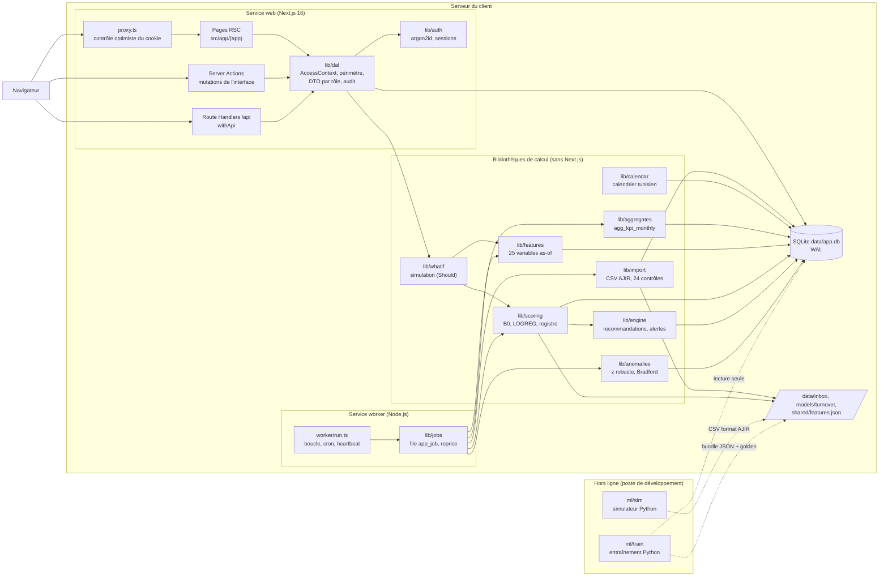
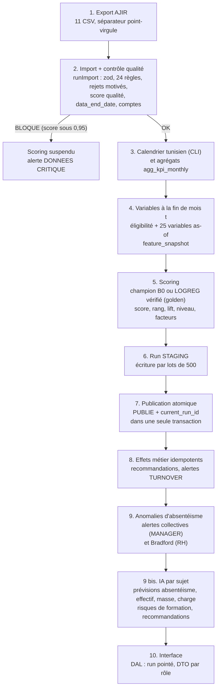

# Architecture — People Analytics & Predictive Turnover (AJIR)

Document de conception du module d'aide à la décision RH intégré à AJIR (ArabSoft). Il décrit l'application **telle qu'elle est codée au 29/09/2026** dans `people-analytics/` et signale explicitement ce que le cahier des charges v2 prévoit mais que le code n'implémente pas (section 10). Références : cahier des charges `../Sujet_PFE_People_Analytics_AJIR_v2.pdf`, plan détaillé `../PLAN_PFE.md`, conventions [docs/CONVENTIONS.md](../CONVENTIONS.md).

| Document | Contenu |
|---|---|
| [CAS_UTILISATION.md](CAS_UTILISATION.md) | Diagramme de cas d'utilisation par acteur, matrice des droits, descriptions textuelles des 8 cas majeurs |
| [MODELE_DONNEES.md](MODELE_DONNEES.md) | Modèle entité-association de toutes les tables (clés, relations), diagramme de classes de la couche applicative |
| [SEQUENCES.md](SEQUENCES.md) | Séquences : connexion et RBAC, import AJIR, batch mensuel, fiche manager avec refus, what-if |
| [DEPLOIEMENT.md](DEPLOIEMENT.md) | Diagramme de déploiement on-premise, configuration, règles d'exploitation |
| [ETATS.md](ETATS.md) | États d'une alerte, d'une recommandation, d'un run, d'un job, d'un lot d'import |
| [../adr/](../adr/README.md) | 13 fiches de décision (ADR) |
| [../DICTIONNAIRE.md](../DICTIONNAIRE.md) | Dictionnaire des données, des KPI, des 25 variables, glossaire RH tunisien |

## 1. Périmètre et principes

- **Aide à la décision uniquement** : le module estime une exposition au risque de démission à 6 mois, l'explique par des « facteurs associés » et suggère des actions ; aucune décision n'est automatisée, aucune donnée AJIR n'est créée ni modifiée (AJIR reste la source de vérité, import en lecture seule).
- **Stack imposée** : React + Next.js 16 + SQLite, TypeScript partout en production ; Python uniquement hors ligne ([ADR-001](../adr/001-stack-react-nextjs-sqlite.md), [ADR-002](../adr/002-python-hors-ligne-modele-json-execute-en-typescript.md)).
- **Trois rôles**, avec séparation des tâches : **Administrateur** (administration de l'outil, sans aucune donnée nominative ni indicateur RH), **Responsable RH** (vue entreprise complète), **Manager** (sa hiérarchie, sans rémunération ni probabilité).
- **Un serveur, un fichier** : un service web, un service worker, un fichier SQLite, des bundles de modèle en JSON.

## 2. Vue d'ensemble des composants

| Composant | Responsabilité | Fichiers |
|---|---|---|
| Proxy | Redirige vers `/login` (ou 401 sur `/api/*`) si le cookie de session est absent ; ne lit pas la base | [src/proxy.ts](../../src/proxy.ts) |
| Pages, Server Actions, Route Handlers | Rendu et mutations ; appellent uniquement la DAL | [src/app/](../../src/app/), [src/lib/api.ts](../../src/lib/api.ts) |
| Authentification | Mots de passe argon2id, sessions opaques, verrouillage | [src/lib/auth/](../../src/lib/auth/) |
| DAL | Seule couche lue par l'interface et l'API : contexte d'accès, périmètre hiérarchique, DTO par rôle, gardes de petites populations, audit | [src/lib/dal/](../../src/lib/dal/) |
| Import | Lecture en flux des 11 CSV, validation zod, 24 règles de contrôle, rejets motivés, score qualité, synchronisation des comptes | [src/lib/import/](../../src/lib/import/) |
| Calendrier | Fériés tunisiens fixes et religieux (table 2019-2030, repli Umm al-Qura), Ramadan, ponts, séance unique ; remplit `dim_date` | [src/lib/calendar/](../../src/lib/calendar/) |
| Agrégats | `agg_kpi_monthly` par mois × département (département reconstitué depuis les mutations) | [src/lib/aggregates/index.ts](../../src/lib/aggregates/index.ts) |
| Variables | Éligibilité et 25 variables à une fin de mois, visibilité par date de saisie, masquage santé ; `feature_snapshot` | [src/lib/features/](../../src/lib/features/), [shared/features.json](../../shared/features.json) |
| Scoring | Chargement et vérification des bundles, score, rang, lift, niveau, explication par groupe, publication atomique | [src/lib/scoring/](../../src/lib/scoring/) |
| Moteur métier | Recommandations et alertes TURNOVER après publication, création idempotente d'alertes | [src/lib/engine/](../../src/lib/engine/) |
| Anomalies | Dérives collectives d'absentéisme corrigées du calendrier, signal individuel de Bradford (RH) | [src/lib/anomalies/index.ts](../../src/lib/anomalies/index.ts) |
| Jobs et worker | File `app_job`, batch mensuel, heartbeat, reprise | [src/lib/jobs/](../../src/lib/jobs/), [src/worker/](../../src/worker/) |
| What-if (Should, en cours) | Recalcul en mémoire des variables et du niveau sous leviers RH | [src/lib/whatif/index.ts](../../src/lib/whatif/index.ts), [src/lib/dal/whatif.ts](../../src/lib/dal/whatif.ts) |
| CLI d'exploitation | Migration, import, pipeline, registre des modèles, sauvegarde, restauration | [scripts/](../../scripts/) |

Les bibliothèques de calcul ne dépendent pas de Next.js (pas de `server-only`) : elles sont partagées par le worker, les CLI, les tests et, pour le what-if, par la DAL.

## 3. Flux de bout en bout

1. **Export AJIR** : un dossier de CSV conforme au contrat ([docs/CONVENTIONS.md](../CONVENTIONS.md)) est téléversé par l'administrateur (`POST /api/imports` → `data/inbox/` → job `IMPORT`) ou importé en ligne de commande (`npm run import`).
2. **Import et qualité** ([src/lib/import/index.ts](../../src/lib/import/index.ts)) : lecture en flux, validation zod ligne à ligne, 24 règles classées REJET, CORRECTION ou AVERTISSEMENT ([rules.ts](../../src/lib/import/rules.ts)), écritures idempotentes (upsert) par lots de 5 000 ; rupture des cycles hiérarchiques ; `data_end_date` = dernier pointage accepté, jamais en recul ; score qualité = moyenne par fichier (lignes acceptées / lignes) × (1 − actifs sans paie du dernier mois / actifs) ; statut **BLOQUE** sous `quality_threshold`. Voir la séquence 2 de [SEQUENCES.md](SEQUENCES.md).
3. **Calendrier et agrégats** : `buildCalendar` (lancé par la CLI d'import et par `pipeline`) remplit `dim_date` ; `refreshAggregates` recalcule `agg_kpi_monthly` dans des tables temporaires puis remplace les mois concernés en une transaction (CLI d'import, pipeline, batch mensuel).
4. **Variables** ([src/lib/features/](../../src/lib/features/)) : pour chaque fin de mois t, éligibilité ([ADR-004](../adr/004-cible-demission-6-mois-risques-concurrents.md)) puis 25 variables en 6 groupes, calculées en mémoire à partir des tables sources, en ne retenant que les lignes visibles à t ([ADR-005](../adr/005-visibilite-as-of-par-date-de-saisie.md)) et en masquant les jours de santé ([ADR-009](../adr/009-exclusion-des-donnees-de-sante.md)) ; écrites dans `feature_snapshot` (clé `employee_id, as_of, fsv`).
5. **Scoring** ([src/lib/scoring/](../../src/lib/scoring/)) : le champion est chargé et revérifié (golden à 1e-9) ; sans champion, B0 est enregistré et promu ; **démarrage à froid** : un champion LOGREG n'est utilisé que si l'historique compte au moins `min_events_for_model` démissions observées (30), sinon le calcul est fait avec B0 et la raison est tracée (audit, page Transparence) ([cold-start.ts](../../src/lib/scoring/cold-start.ts)) ; salariés opposés exclus ; score, rang, lift, niveau par capacité ([ADR-006](../adr/006-niveaux-de-risque-par-capacite-rh.md)), contributions exactes par groupe (au plus 6 facteurs stockés).
6. **Run STAGING** puis 7. **publication atomique** par pointeur ([ADR-008](../adr/008-publication-atomique-par-pointeur.md)).
8. **Effets métier** ([src/lib/engine/recommendations.ts](../../src/lib/engine/recommendations.ts)) : recommandations sur les groupes actionnables en hausse du top 3 (ÉLEVÉ et MOYEN) et entretien pour les ÉLEVÉ ; alertes TURNOVER pour les nouveaux ÉLEVÉ ; idempotents.
9. **Anomalies** ([src/lib/anomalies/index.ts](../../src/lib/anomalies/index.ts)) : taux hebdomadaire d'absence non planifiée hors santé par équipe et département (au moins 5 actifs), comparé à la médiane des 26 semaines précédentes désaisonnalisée par classe calendaire (Ramadan, férié ou pont, séance unique, normale) ; signal si le z robuste dépasse 3,5 deux semaines de suite ; facteur de Bradford individuel au-dessus du seuil, pour la RH, formulé « à vérifier ».
9 bis. **IA par sujet** ([src/lib/ai/steps.ts](../../src/lib/ai/steps.ts)) : un champion par sujet dans `topic_model`, étape idempotente par sujet, une erreur n'arrête pas les autres : prévision à 1-3 mois du taux d'absence hors santé non planifiée (entreprise, départements, équipes d'au moins 5 personnes), projection à 12 mois de l'effectif et de la masse salariale (stock-flux, taux historiques ou probabilités LOGREG publiées), risque de retard des formations obligatoires ouvertes (`training_risk`), prévision des heures supplémentaires par équipe et surcharge individuelle soutenue (règle) ; résultats dans `forecast` (agrégés) et `insight_recommendation`. Environ 1 s sur la base de démonstration.
10. **Interface** : toutes les lectures passent par la DAL et le run pointé ; les pages ne reçoivent que des DTO du rôle.

Déclencheurs : cron du worker le 10 du mois à 02:00 (Africa/Tunis) → `BATCH_MENSUEL` (étapes 3 sans calendrier, puis 4 à 9 bis) ; bouton « Recalculer » de l'administrateur (même job) ; `POST /api/predictions/run` (RH, ADMIN : job `SCORING`, étapes 4 à 8, variables calculées si absentes) ; `npm run pipeline [--backtest]` en ligne de commande (étapes 3 à 9 bis, avec l'historique des runs en backtest).

## 4. Organisation de la base SQLite

35 tables et une vue (détail : [MODELE_DONNEES.md](MODELE_DONNEES.md), [DICTIONNAIRE.md](../DICTIONNAIRE.md)) :

- **Sources AJIR** (écrites par l'import seulement) : `department`, `employee`, `contract`, `exit_event`, `career_event`, `attendance_daily`, `absence_episode`, `payroll_monthly`, `training`, `evaluation` ; chaque source différée porte `recorded_at`.
- **Calendrier et imports** : `dim_date`, `import_batch` (rapport JSON complet), `import_rejection` (au plus 1 000 lignes détaillées par fichier et par règle, les comptages complets restant dans le rapport).
- **Agrégats** : `agg_kpi_monthly` (mesures additives par mois × département), à la place des vues matérialisées.
- **Couche ML** : `feature_snapshot`, vue `v_label_panel` (seule définition des étiquettes), `model_version` (un seul CHAMPION par index unique partiel).
- **Résultats de run** : `scoring_run`, `prediction`, `prediction_factor`, filtrés par le pointeur `current_run_id`.
- **Objets métier persistants** : `recommendation`, `intervention`, `alert` (déduplication par `dedup_key`), `anomaly`.
- **IA par sujet** : `topic_model` (registre, un champion par sujet), `forecast` (prévisions agrégées ; horizon 0 = observé), `training_risk` (risque de retard de formation), `insight_recommendation` (recommandations par sujet, `dedup_key` unique).
- **Protection des données** : `privacy_request` (demandes d'accès, d'opposition, de rectification), `employee_opposition` (salariés exclus de tout traitement prédictif).
- **Application** : `app_user`, `session`, `audit_log` (ajout seul), `app_job`, `app_setting` (paramètres, `current_run_id`, `data_end_date`, `worker_heartbeat`).

## 5. Déploiement on-premise

Trois services Windows (WinSW) sur le serveur du client : web (`next start` sur 127.0.0.1:3000), worker, et reverse proxy Caddy en HTTPS avec le certificat de la PKI interne ([deploy/](../../deploy/), [docs/INSTALLATION.md](../INSTALLATION.md)) ; un fichier `data/app.db` en mode WAL, un dossier `data/inbox/` pour les exports, `models/turnover/` et `models/<sujet>/` pour les bundles, `data/backups/` pour les sauvegardes. Python et Docker ne sont jamais requis chez le client. Diagramme, variables d'environnement et règles d'exploitation : [DEPLOIEMENT.md](DEPLOIEMENT.md).

## 6. Modèle de sécurité

### 6.1 Authentification et sessions ([ADR-012](../adr/012-sessions-opaques-plutot-que-jwt.md))

- Mots de passe argon2id (m = 19 Mio, t = 2, p = 1), politique ≥ 10 caractères avec lettres et chiffres ; comptes créés sans mot de passe puis activés par un lien à usage unique (7 jours, empreinte SHA-256).
- Session opaque : jeton aléatoire de 32 octets dans le cookie `pa_session` (httpOnly, SameSite=Lax, Secure en production), empreinte SHA-256 comme clé en base ; **expiration glissante** : la session tombe après 2 h sans requête (`SESSION_IDLE_MINUTES`), chaque usage repousse `expires_at`, jamais au-delà de 10 h après la connexion ; sessions expirées **purgées** à chaque connexion, au plus tous les quarts d'heure et par `scripts/retention.ts` ; révocable par suppression (déconnexion, désactivation, activation, synchronisation, changement de mot de passe, restauration).
- Limitation de débit en mémoire ([src/lib/auth/rate-limit.ts](../../src/lib/auth/rate-limit.ts)), en plus du verrouillage progressif en base : connexion 30 échecs par IP et par 15 min, activation 20 par IP et 10 par compte ; la clé IP n'est appliquée que si l'adresse est fiable (`TRUST_PROXY=1` derrière Caddy), pour qu'un tiers ne puisse jamais bloquer tous les utilisateurs.
- Verrouillage progressif dès le 5e échec (1 à 64 min), tentative réservée en transaction `BEGIN IMMEDIATE` ; message d'échec identique pour identifiant inconnu et mot de passe faux ; toutes les tentatives journalisées.

### 6.2 Proxy optimiste

[src/proxy.ts](../../src/proxy.ts) (le `middleware` de Next.js 16 s'appelle `proxy`) ne vérifie que la présence du cookie sur toutes les routes sauf `/login`, `/activation`, `/api/health` et les ressources statiques. Il ne lit pas la base et ne décide d'aucun droit : un cookie forgé passe le proxy mais échoue à `readSession`.

### 6.3 Contrôle d'accès par rôle

| Surface | ADMIN | RH | MANAGER | Garde |
|---|---|---|---|---|
| `/admin` (console : comptes, sessions ouvertes, refus d'accès), `/admin/users`, `/admin/settings`, `/admin/audit`, `GET/POST /api/admin/users` | oui | non | non | `pageContext(["ADMIN"])`, `requireContext(["ADMIN"])`, `ensureRole` |
| `/dashboard`, `/employees`, `/employees/[id]`, `/absenteeism`, `GET /api/dashboard`, `GET /api/employees[/id]` | non | entreprise | sa hiérarchie | `pageContext(PILOTAGE_ROLES)`, `ensurePilotage`, `canSeeEmployee` |
| `/recommendations`, `/backtesting`, `POST /api/employees/[id]/what-if` | non | oui | non | `pageContext(["RH"])`, `requireGlobal`, `isGlobal` |
| `/data-health`, `/transparency`, `GET /api/imports` | oui | oui | non | `pageContext(["ADMIN","RH"])`, `ensureRole` |
| `POST /api/imports` (téléversement), recalcul mensuel | oui | non | non | `ensureRole(ctx, ["ADMIN"])` |
| `POST /api/predictions/run` | oui | oui | non | `requestScoring` |
| `/alerts`, `GET /api/alerts`, `PATCH /api/alerts/[id]` | alertes SYSTEME et DONNEES non nominatives | tout sauf audience ADMIN | audience MANAGER de sa hiérarchie | `visibility(ctx)` |
| `/compte`, `GET /api/me` | oui | oui | oui | session seule ; données de l'utilisateur connecté |
| `GET /api/health` | public | public | public | aucune donnée sensible |

Codes : 401 sans session, 403 hors rôle ou hors périmètre, 404 ressource absente (testée avant le périmètre), 400 paramètre invalide, 409 conflit d'état. Côté pages : `/login`, `/interdit`, `notFound()`.

### 6.4 Couche d'accès aux données et périmètre hiérarchique ([ADR-007](../adr/007-couche-acces-donnees-au-lieu-rls.md))

- `AccessContext` construit côté serveur depuis la session, passé à **toutes** les fonctions de [src/lib/dal/](../../src/lib/dal/).
- Périmètre du manager : CTE récursive `WITH RECURSIVE team` sur `employee.manager_id` depuis le salarié lié au compte, le manager lui-même exclu (`SCOPE_SUBQUERY`, `scopeFilter`, `canSeeEmployee`, `visibleEmployeeIds`) ; les filtres utilisateur (département, manager) s'ajoutent en conjonction et ne peuvent pas élargir le périmètre.
- `isGlobal(ctx)` n'est vrai que pour la RH ; pour l'ADMIN, `scopeFilter` renvoie `1=0`.
- Hiérarchie utilisée : celle du **dernier import** (pas de hiérarchie datée).

### 6.5 DTO par rôle

Liste blanche explicite ([src/lib/dal/employees.ts](../../src/lib/dal/employees.ts), [dashboard.ts](../../src/lib/dal/dashboard.ts)) :

| Donnée | RH | MANAGER |
|---|---|---|
| Salaire, historique de paie, masse salariale | oui | jamais |
| Probabilité ou points, lift, version du modèle | oui | jamais (niveau seul) |
| Facteurs | phrase chiffrée (`phrase_rh`), contribution, sens | catégorie (`phrase_manager`), sans `ABSENCES`, sans `REMUNERATION` si B0 |
| Absences individuelles | par catégorie hors santé + total santé sur 12 mois | aucune |
| Carrière | tous les événements | sans `AUGMENTATION` |
| Recommandations | toutes, décision et retour | lecture, sans `REVISION_SALARIALE` |
| Signaux d'absentéisme individuels | oui | jamais |
| Filtres contrat, âge, ancienneté du tableau de bord | oui | ignorés et signalés |

Les pages rendues côté serveur ne reçoivent que ces DTO : les valeurs exclues ne peuvent donc apparaître ni dans le HTML ni dans le payload RSC (vérifié par des tests récursifs sur les DTO et sur le rendu des pages, [tests/pilotage/](../../tests/pilotage/)).

### 6.6 Gardes de petites populations ([ADR-011](../adr/011-gardes-petites-populations-cote-manager.md))

Côté manager, aucun taux d'absence, turnover ou nombre de sorties sur moins de 5 personnes, ni déductible par différence (masquage secondaire, complément d'un filtre) ; anomalies collectives suivies seulement pour les groupes d'au moins 5 actifs.

### 6.7 Audit append-only

- Table `audit_log` protégée par deux triggers (`BEFORE UPDATE`, `BEFORE DELETE` → `RAISE(ABORT)`, [drizzle/0001_audit_triggers.sql](../../drizzle/0001_audit_triggers.sql)).
- Écritures journalisées : `auth.login`, `auth.logout`, `user.create`, `user.activate`, `user.activation_link`, `user.deactivate`, `user.reactivate`, `user.unlock`, `user.password_change`, `settings.update`, `import.upload`, `import.run`, `job.enqueue`, `scoring.publish`, `model.register`, `model.promote`, `model.rollback`, `alert.update`, `recommendation.decide`, `recommendation.feedback`, `backup.restore`.
- Lectures sensibles journalisées : `employee.view` (avec indicateurs `salary` et `score`), `whatif.run`, `backtest.view`.
- Refus journalisés (`outcome = REFUSE`) : toute décision de la DAL (`employee.view`, `employee.list`, `dashboard.view`, `absenteeism.view`, `alert.view`, `alert.update`, `recommendation.*`, `whatif.run`, `import.*`, `data_health.view`, `model.view`, `user.*`, `settings.*`, `audit.view`, `admin.overview`, `job.enqueue`…).
- Consultation : `/admin/audit` (ADMIN), filtres par utilisateur, préfixe d'action, résultat, période ; la console `/admin` affiche les derniers refus.
- Si l'insertion d'audit échoue, l'exception interrompt la lecture sensible (l'audit est écrit avant le retour du DTO).

### 6.8 Entrées, CSRF, erreurs, en-têtes

- Validation zod de toutes les entrées (paramètres de requête en mode strict pour l'API, tolérant et signalé pour les pages ; corps JSON ; formulaires ; lignes CSV).
- CSRF : SameSite=Lax ; contrôle d'origine natif des Server Actions ; `withApi` refuse les méthodes mutantes dont l'en-tête `Origin` ne correspond pas à `Host`/`X-Forwarded-Host`.
- Erreurs API homogènes `{ error: { code, message, correlationId } }`, sans détail interne ; les erreurs 500 sont journalisées par pino avec l'identifiant de corrélation.
- En-têtes : `X-Content-Type-Options: nosniff`, `X-Frame-Options: SAMEORIGIN`, `Referrer-Policy: same-origin`, Content-Security-Policy et, en production, HSTS posés par [next.config.ts](../../next.config.ts), en-tête `X-Powered-By` supprimé ; le reverse proxy ([deploy/caddy/Caddyfile](../../deploy/caddy/Caddyfile)) les pose aussi, avec Permissions-Policy et Cross-Origin-Opener-Policy ; la CSP autorise `'unsafe-inline'` pour les scripts et styles (Next.js sans nonce).
- Accès à la base : une règle ESLint (`no-restricted-imports`, [eslint.config.mjs](../../eslint.config.mjs)) interdit d'importer `@/db/client` dans les pages, composants, Route Handlers et le proxy ; seuls `src/lib/**` (DAL et moteurs), `src/db`, le worker, les scripts et les tests y ont droit.
- SQL : requêtes préparées à paramètres nommés ; aucune concaténation de valeur utilisateur (les seuls fragments dynamiques sont des clauses de périmètre et des ordres de tri issus de listes fermées).

### 6.9 Minimisation et données sensibles

Santé exclue de toute variable et de tout score ([ADR-009](../adr/009-exclusion-des-donnees-de-sante.md)) ; sexe, âge, situation familiale et gouvernorat exclus des variables, conservés pour l'audit d'équité hors ligne ; libellés « estimation », « facteurs associés », « à vérifier » ; séparation des tâches ADMIN / RH (dans les rejets d'import, l'ADMIN ne voit que le matricule : ni montant, ni valeur brute sensible, ni date ou catégorie d'absence, [src/lib/privacy/mask.ts](../../src/lib/privacy/mask.ts)) ; droit d'opposition appliqué à tout traitement individuel (`excludeOpposed`) ; rétention outillée ([scripts/retention.ts](../../scripts/retention.ts)).

## 7. Choix liés à SQLite

| Choix | Mise en œuvre |
|---|---|
| Mode WAL et réglages | `journal_mode = WAL`, `busy_timeout = 5000`, `synchronous = NORMAL`, `foreign_keys = ON` à chaque ouverture ([src/db/client.ts](../../src/db/client.ts)) ; lecteurs concurrents d'un écrivain |
| Un seul écrivain de masse | le worker (import, agrégats, variables, runs, anomalies) ; Next.js n'écrit que des lignes unitaires (sessions, audit, statuts, interventions, paramètres, jobs) ; les CLI ne doivent pas tourner pendant un job ([ADR-013](../adr/013-worker-separe-et-file-de-jobs-sqlite.md)) |
| Transactions courtes | `BEGIN IMMEDIATE` (`.immediate()`) pour prendre le verrou d'écriture d'emblée ; lots de 500 prédictions, 5 000 lignes d'import ; agrégats calculés en tables temporaires puis remplacement en une transaction ; index secondaire des pointages supprimé puis reconstruit lors d'un gros import |
| Pointeur de publication | `app_setting.current_run_id` + statut `PUBLIE` ([ADR-008](../adr/008-publication-atomique-par-pointeur.md)) |
| Unicité métier par index partiels | un seul champion (`model_one_champion`), un seul job actif par type et cible (`job_one_active`) |
| Agrégats pré-calculés | `agg_kpi_monthly` à la place des vues matérialisées ; recalcul direct depuis les sources, avec les mêmes définitions, quand un filtre de population ou le périmètre manager l'exige |
| Sauvegarde | `VACUUM INTO` à chaud, `integrity_check`, manifeste sha256, rétention 30 jours ; restauration à froid avec copie de sécurité ([scripts/backup.ts](../../scripts/backup.ts), [scripts/restore.ts](../../scripts/restore.ts)) |
| Migrations | Drizzle Kit (`drizzle/*.sql`) ; triggers et vue en migrations SQL personnalisées ; appliquées par `npm run db:migrate` et au démarrage du worker |
| Volumétrie constatée | base de démonstration : ≈ 2 450 salariés, 72 mois, 1,56 million de pointages, 155 Mo ; import ≈ 30 s ; pipeline du dernier mois ≈ 15 s (agrégats 4,5 s, variables de 72 mois 7,9 s, scoring 0,2 s, anomalies 0,2 s, IA par sujet 1 s, mesuré le 30/09/2026) ([docs/DEMO.md](../DEMO.md)) |

## 8. Choix liés à Next.js 16

- **App Router et Server Components** : les pages de `src/app/(app)/` sont des composants serveur qui appellent directement la DAL ; le layout du groupe `(app)` vérifie la session (`pageContext()`), chaque page vérifie à nouveau ses rôles (les layouts ne sont pas réévalués à chaque navigation).
- **`proxy.ts`** (ex-`middleware`) : contrôle optimiste de présence du cookie seulement (6.2).
- **API asynchrones** : `cookies()`, `headers()`, `params` et `searchParams` sont des promesses ([src/lib/auth/session.ts](../../src/lib/auth/session.ts), pages dynamiques).
- **Server Actions** pour toutes les mutations de l'interface (connexion, activation, alertes, recommandations, comptes, paramètres, recalcul, mot de passe) : protection CSRF native, validation zod, appel de la DAL, puis `revalidatePath` ou `refresh()`.
- **Route Handlers** encapsulés par `withApi` ([src/lib/api.ts](../../src/lib/api.ts)) : contrôle d'origine sur les méthodes mutantes, conversion homogène des erreurs (`HttpError`, `ZodError`, 500 avec `correlationId`), `Cache-Control: no-store` sur les réponses de fiche, de liste, de tableau de bord, de what-if, de `/api/me` et de `/api/health` (pas sur `/api/alerts` ni `/api/imports`).
- **Streaming et redirections** : la fiche `/employees/[id]` n'a pas de `loading.tsx` au-dessus d'elle, pour que la vérification de périmètre précède le streaming et produise une vraie redirection 307 vers `/interdit` et un vrai 404.
- **Modules natifs** : `better-sqlite3`, `@node-rs/argon2` et `pino` déclarés dans `serverExternalPackages` ; `distDir` configurable (`NEXT_DIST_DIR`) pour des builds isolés.
- **`server-only`** importé par la DAL, l'authentification et `withApi` ; remplacé par un module vide dans Vitest ([vitest.config.ts](../../vitest.config.ts)).

## 9. Qualité et tests

Vitest et fast-check ([src/**/*.test.ts](../../src/), [tests/](../../tests/)) : import (contrôles, idempotence, bornes des pointages, synchronisation des comptes), calendrier, agrégats (égalité agrégats / calcul détaillé), variables (exemples calculés à la main, troncature, santé, anti-fuite par perturbation, mode naïf), scoring (golden, niveaux, publication), jobs (unicité, reprise), anomalies (pic détecté, Ramadan non signalé, ablation sans calendrier), DAL et pages (périmètre, 401/403/404, DTO manager sans rémunération ni probabilité, petites populations), administration (activation, paramètres, audit), IA par sujet (parité TypeScript / Python sur les golden, étapes idempotentes, périmètres), protection des données (opposition, export du droit d'accès, rétention, masquage), durcissement (sessions glissantes, limitation de débit, en-têtes, règle ESLint). Au 30/09/2026 : 78 fichiers, 650 tests Vitest (hors `tests/security`, lancés par `npm run test:security` contre un serveur isolé) ; 93 tests Playwright de bout en bout avec contrôle d'accessibilité axe-core ([docs/qa/BUGS_E2E.md](../qa/BUGS_E2E.md)) ; 67 tests pytest pour `ml/`. k6 et OWASP ZAP, prévus au cahier, ne sont pas intégrés (mesures de charge par [scripts/perf.ts](../../scripts/perf.ts)).

## 10. Écarts constatés entre le cahier des charges et le code

| Exigence du cahier (ou du plan) | État dans le code au 30/09/2026 |
|---|---|
| Régression logistique calibrée en production | Champion `logreg-v1-20260930` (Platt hors échantillon, golden reproduit à 1,1e-16) ; repli automatique sur B0 sous 30 démissions observées (démarrage à froid) |
| Hiérarchie « à la date consultée » pour le périmètre manager | Hiérarchie courante (dernier import) |
| Règle « seule la DAL accède à la base » vérifiée par le linter | Règle ESLint `no-restricted-imports` hors `src/lib`, `src/db`, worker, scripts et tests |
| Séparation des tâches ADMIN / RH (aucune donnée nominative pour l'ADMIN) | Appliquée aux écrans de pilotage ; dans les rejets d'import, l'ADMIN ne voit que le matricule (arbitrage : nécessaire à la correction dans AJIR) ; identifiants visibles dans le journal d'audit |
| Tentatives hors périmètre renvoyant 403 et journalisées | Oui dans la DAL, et refus de rôle au niveau page ou route journalisés (`access.page`, `access.api`) |
| Export audité des données d'un salarié (droit d'accès, M3) | Livré (export audité, demandes et opposition, [docs/conformite/](../conformite/)) |
| Jeton signé depuis le menu AJIR (Should) ; lien profond par matricule | Livrés : `GET /api/ajir/launch` (HMAC-SHA256, 60 s, usage unique), `/go/collaborateur/<matricule>`, `/go/tableau-de-bord` ([INTEGRATION_AJIR.md](../INTEGRATION_AJIR.md)) |
| Agrégats rafraîchis après chaque import | Oui, en CLI et par le job `IMPORT` du worker (calendrier et agrégats reconstruits après un import OK ou BLOQUE) |
| Alertes TURNOVER « non signalé depuis 90 jours » (plan) | Alerte à l'entrée en ÉLEVÉ par rapport au run publié précédent |
| État « Obsolète » et retour arrière de run | Retour arrière du calcul publié livré (`npm run runs -- rollback <runId>`, audité `scoring.rollback`) ; pas d'état « Obsolète » |
| Interventions prises en compte au réentraînement | Enregistrées, pas encore exploitées par `ml/train` |
| Expiration glissante et purge des sessions (plan) | Livrées : 2 h d'inactivité, 10 h au plus, purge des sessions expirées |
| Reverse proxy TLS, CSP, HSTS, services Windows, sauvegarde planifiée | Fournis dans [deploy/](../../deploy/) (Caddy, WinSW, tâche de sauvegarde) ; CSP avec `'unsafe-inline'` ; archive d'installation hors ligne produite en CI non fournie |
| shadcn/ui, TanStack Table, React Hook Form, Playwright, k6, ZAP, CI | Non utilisés ou non intégrés |
| Anomalies : équipes de moins de 8 agrégées au département (plan) | Seuil de 5 actifs, pas d'agrégation au département |
| Définition des jours ouvrés | Agrégats et tableau de bord : lundi-vendredi hors fériés (ponts ouvrés), jours ouvrables proratisés par salarié entre embauche et sortie dans les deux calculs (harmonisés le 30/09/2026) ; variables et anomalies : ponts non ouvrés (écart assumé : un pont est souvent chômé, il ne doit pas compter comme jour sans pointage ; l'aligner changerait le jeu de variables `v1` et imposerait un réentraînement) |
| What-if, backtesting, page Transparence (Should) | Livrés ; what-if sans courbe 3/6/12 mois (horizon unique) ; backtesting du champion sur les runs enregistrés ou calculé à la volée |
| IA par sujet (au-delà du cahier) | Absentéisme, effectifs et masse salariale, formations, charge de travail : modèles hors ligne, inférence TypeScript vérifiée par golden, pages dédiées ; résultats sur données simulées seulement |
