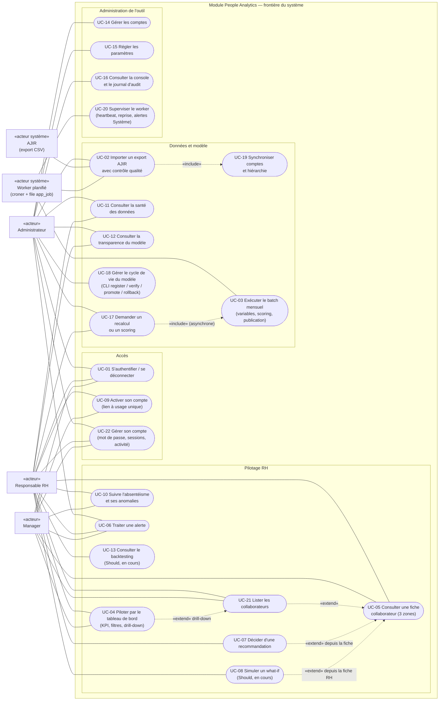

# Cas d'utilisation

Diagramme de cas d'utilisation du module People Analytics, par acteur, tel que le code l'implémente (état au 29/09/2026). Mermaid n'ayant pas de diagramme de cas d'utilisation natif, il est rendu en `flowchart` : les acteurs sont des rectangles marqués « acteur », les cas d'utilisation des ovales, le cadre représente la frontière du système. Les droits sont ceux appliqués par la couche d'accès aux données ([src/lib/dal/context.ts](../../src/lib/dal/context.ts)) et par les gardes de pages (`pageContext`) et de routes (`requireContext`).

Séparation des tâches : l'**Administrateur** administre l'outil (comptes, paramètres, audit, imports, modèle, supervision) mais **ne voit aucune donnée nominative ni indicateur RH** (`isGlobal(ctx)` ne vaut que pour le rôle RH, `PILOTAGE_ROLES = ["RH", "MANAGER"]`, page d'accueil `/admin`). Le **Responsable RH** a la vue entreprise complète. Le **Manager** ne voit que sa hiérarchie, sans rémunération ni probabilité.

## Diagramme

Lecture : un trait plein relie un acteur à un cas qu'il déclenche ou auquel il participe ; une flèche pointillée « include » indique un sous-cas toujours exécuté, « extend » un prolongement optionnel. Le Worker est un acteur système : il exécute les imports mis en file, le batch mensuel (cron `0 2 10 * *`, fuseau Africa/Tunis) et la reprise après arrêt ([src/worker/run.ts](../../src/worker/run.ts)).

## Matrice des droits par rôle

| Cas | ADMIN | RH | MANAGER | Garde dans le code |
|---|---|---|---|---|
| UC-01, UC-09, UC-22 | oui | oui | oui | [src/lib/auth/login.ts](../../src/lib/auth/login.ts), [src/lib/dal/admin.ts](../../src/lib/dal/admin.ts) `activateAccount`, [src/lib/dal/account.ts](../../src/lib/dal/account.ts) `changeOwnPassword` (autres sessions révoquées) |
| UC-04 tableau de bord | non (403 audité `dashboard.view`) | entreprise | sa hiérarchie, sans masse salariale ni lift | `pageContext(PILOTAGE_ROLES)`, `ensurePilotage` ([dashboard.ts](../../src/lib/dal/dashboard.ts)) |
| UC-21 liste | non | tous les actifs, estimation | sa hiérarchie, niveau seul | `ensurePilotage(ctx, "employee.list")` ([employees.ts](../../src/lib/dal/employees.ts)) |
| UC-05 fiche | non (403 audité `employee.view`) | complète | restreinte (liste blanche) | `canSeeEmployee`, `toManagerDetailDto` |
| UC-10 absentéisme | non | tout + signaux individuels | ses équipes, masquage des petits groupes | `ensurePilotage(ctx, "absenteeism.view")` ([absenteeism.ts](../../src/lib/dal/absenteeism.ts)) |
| UC-06 alertes | audience ADMIN et alertes DONNEES non nominatives | tout sauf audience ADMIN | audience MANAGER de sa hiérarchie, jamais d'absentéisme individuel | `visibility()` ([alerts.ts](../../src/lib/dal/alerts.ts)) |
| UC-07 recommandations | non | oui | non (403 audité) | `requireGlobal` ([recommendations.ts](../../src/lib/dal/recommendations.ts)) |
| UC-08 what-if, UC-13 backtesting | non | oui | non | `isGlobal` ([whatif.ts](../../src/lib/dal/whatif.ts), [backtest.ts](../../src/lib/dal/backtest.ts)) |
| UC-11 santé des données, UC-12 transparence | oui | oui | non | `ensureRole(ctx, ["ADMIN","RH"], …)` ([imports.ts](../../src/lib/dal/imports.ts), [model.ts](../../src/lib/dal/model.ts)) |
| UC-02 téléversement, UC-17 recalcul mensuel | oui | non | non | `ensureRole(ctx, ["ADMIN"], "import.upload")`, `requestRecompute` |
| UC-17 scoring d'un mois (API `POST /api/predictions/run`) | oui | oui | non | `requestScoring` |
| UC-14, UC-15, UC-16 | oui | non | non | `ensureRole(ctx, ["ADMIN"], …)` ([admin.ts](../../src/lib/dal/admin.ts)) |
| UC-18 cycle de vie du modèle | exploitant (CLI serveur) | non | non | [scripts/model.ts](../../scripts/model.ts), aucune interface web |

## Descriptions textuelles des 8 cas majeurs

### UC-01 — S'authentifier

- **Acteurs** : Administrateur, Responsable RH, Manager.
- **Préconditions** : compte `app_user` actif doté d'un mot de passe (créé par `seed:admin`, par l'administrateur ou par la synchronisation `users.csv`, puis activé par lien). HTTPS en production (cookie `Secure`).
- **Scénario nominal** :
  1. L'utilisateur ouvre une page protégée ; [src/proxy.ts](../../src/proxy.ts) constate l'absence du cookie `pa_session` et redirige vers `/login` (401 JSON pour `/api/*`).
  2. Il saisit identifiant et mot de passe ; la Server Action `loginAction` valide le formulaire (zod) et appelle `login()`.
  3. Le système réserve la tentative dans une transaction `BEGIN IMMEDIATE` (compteur `failed_attempts`), vérifie le hachage argon2id, remet le compteur à zéro.
  4. Il crée une session opaque : jeton aléatoire de 32 octets dans le cookie (httpOnly, SameSite=Lax), empreinte SHA-256 en base, expiration à 10 h.
  5. Il journalise `auth.login` OK et redirige vers `/`, qui renvoie vers `/admin` (ADMIN) ou `/dashboard` (RH, MANAGER).
- **Alternatives** :
  - A1 identifiant inconnu, compte inactif ou sans mot de passe : message générique identique à un mauvais mot de passe, `auth.login` REFUSE.
  - A2 mot de passe faux : compteur incrémenté ; à partir de la 5e tentative échouée, verrouillage de 1, 2, 4… jusqu'à 64 minutes.
  - A3 compte verrouillé : refus sans vérifier le mot de passe, REFUSE `verrouille`.
  - A4 déconnexion : suppression de la ligne `session`, effacement du cookie, `auth.logout`.
  - A5 page hors rôle (ex. ADMIN sur `/employees`) : redirection `/interdit` ; route API hors rôle : 403 JSON.

### UC-02 — Importer un export AJIR avec contrôle qualité

- **Acteurs** : Administrateur (téléversement), Worker (traitement), AJIR (source de l'export) ; exploitant en ligne de commande (`npm run import`).
- **Préconditions** : export au format du contrat ([docs/CONVENTIONS.md](../CONVENTIONS.md) : CSV `;`, UTF-8, en-têtes), `departments.csv` et `employees.csv` présents ; aucun import déjà en file ou en cours.
- **Scénario nominal** :
  1. L'administrateur dépose les CSV dans *Santé des données* ; `POST /api/imports` (multipart) contrôle l'origine, le rôle, les noms de fichiers (liste fermée), la taille (≤ 9 Mo) et la présence d'un en-tête avec `;`.
  2. Les fichiers sont écrits dans `data/inbox/<horodatage>/`, un job `IMPORT` est mis en file (un seul actif), l'action est auditée (`import.upload`, `job.enqueue`) ; réponse 202.
  3. Le worker prend le job et lance `runImport` ([src/lib/import/index.ts](../../src/lib/import/index.ts)) : lecture en flux, validation zod ligne à ligne, règles métier (24 contrôles), écriture par lots de 5 000 lignes, rejets motivés dans `import_rejection`.
  4. Il résout la hiérarchie (manager inexistant, cycles rompus), met à jour `data_end_date` (dernier pointage accepté, jamais en recul), le statut des salariés, contrôle la complétude de la paie et la variation de volume, synchronise les comptes (UC-19).
  5. Il calcule le score qualité (moyenne par fichier de lignes acceptées × complétude de la paie) : statut OK si ≥ `quality_threshold` (0,95).
  6. Il enregistre le rapport, crée une alerte DONNEES si des lignes sont rejetées, et journalise `import.run`.
  7. La RH ou l'administrateur consulte le détail des rejets par règle et par fichier.
- **Alternatives** :
  - A1 score sous le seuil : statut BLOQUE, alerte DONNEES CRITIQUE ; tout scoring est refusé (409 `SCORING_BLOQUE`) jusqu'à un import conforme. Les lignes valides restent néanmoins écrites dans les tables sources.
  - A2 fichier obligatoire absent ou en-tête invalide sur un fichier obligatoire : statut ECHEC, alerte CRITIQUE.
  - A3 fichier hors contrat, doublon de fichier, export trop volumineux, import déjà en cours : refus immédiat (400/409/413/422), rien n'est écrit.
  - A4 import en ligne de commande : même `runImport`, puis construction du calendrier tunisien et rafraîchissement des agrégats ([scripts/import.ts](../../scripts/import.ts)).

### UC-03 — Exécuter le batch mensuel

- **Acteurs** : Worker (déclencheur planifié), Administrateur (relance manuelle `BATCH_MENSUEL`), RH ou Administrateur (scoring d'un mois via l'API).
- **Préconditions** : dernier import terminé non BLOQUE ; données couvrant la fin du mois (`data_end_date`) ; champion valide (sinon B0 est enregistré et promu automatiquement).
- **Scénario nominal** :
  1. Le 10 du mois à 02:00 (Tunis), le cron détermine le dernier mois complet non encore publié et met en file un job `BATCH_MENSUEL`.
  2. Le worker rafraîchit `agg_kpi_monthly`, calcule les 25 variables de chaque salarié éligible à la fin du mois (`feature_snapshot`), puis `scoreMonth` : score, rang, lift, niveau, facteurs.
  3. Les prédictions sont écrites dans un run `STAGING` par lots de 500 ; une dernière transaction passe le run en `PUBLIE` et déplace le pointeur `current_run_id`.
  4. Les effets métier sont appliqués de façon idempotente : recommandations (groupe actionnable dans le top 3, entretien si ÉLEVÉ), alertes TURNOVER des nouveaux ÉLEVÉ.
  5. La détection d'anomalies d'absentéisme tourne sur les semaines du mois (alertes collectives et signaux Bradford).
  6. Le job passe `TERMINE` ; les pages lisent le nouveau run.
- **Alternatives** :
  - A1 erreur pendant l'écriture : run `ECHEC`, alerte SYSTEME, le pointeur n'a pas bougé (l'interface reste sur le calcul précédent).
  - A2 worker arrêté en plein calcul : au redémarrage (ou toutes les 60 s), un job sans heartbeat depuis 10 min est remis en file une fois puis passe `ECHEC` ; un run `STAGING` orphelin passe `ECHEC`.
  - A3 mois déjà publié ou non couvert par les données : le cron ne met rien en file (journal worker).
  - A4 champion invalide (golden non reproduit, fichier modifié) : alerte SYSTEME, scoring suspendu.

### UC-04 — Piloter par le tableau de bord

- **Acteurs** : Responsable RH, Manager.
- **Préconditions** : session valide ; agrégats calculés ; idéalement un run publié.
- **Scénario nominal** :
  1. L'utilisateur ouvre `/dashboard` ; les filtres (période 3 à 24 mois, département, contrat, âge, ancienneté, niveau) sont validés par zod (valeur invalide ignorée et signalée sur la page, 400 sur l'API).
  2. La DAL lit `agg_kpi_monthly` (RH, sans filtre de population) ou recalcule depuis les sources avec les mêmes définitions (filtres, manager).
  3. Elle renvoie le DTO du rôle : effectif, entrées, sorties, turnover glissant 12 mois total et volontaire, absentéisme hors santé non planifié, formations obligatoires, masse salariale (RH), niveaux de risque par département et part non évaluée.
  4. L'utilisateur clique un département ou un niveau : la liste `/employees` s'ouvre avec les mêmes filtres, puis la fiche (UC-05).
- **Alternatives** :
  - A1 Manager : filtres contrat, âge et ancienneté ignorés et signalés ; taux et sorties masqués sous 5 personnes (ou si le complément dans son périmètre compte moins de 5).
  - A2 aucun run publié : bloc risque vide avec message explicite.
  - A3 Administrateur : redirigé vers `/interdit` (page) ou 403 audité (API).

### UC-05 — Consulter une fiche collaborateur

- **Acteurs** : Responsable RH, Manager.
- **Préconditions** : session valide ; le salarié existe.
- **Scénario nominal** :
  1. L'utilisateur ouvre `/employees/{id}` ; la page appelle `getEmployeeDetail(ctx, id)`.
  2. La DAL vérifie l'existence (sinon 404), puis le périmètre (`canSeeEmployee` : RH tout, Manager sa hiérarchie récursive).
  3. Elle charge les observations (contrat, fin de CDD prévue, carrière, paie 12 mois, absences hors santé par catégorie, formations, évaluations), l'estimation du run publié (niveau, score ou probabilité, facteurs, historique 12 mois) et les recommandations.
  4. Elle journalise `employee.view` OK (vue, accès au salaire, au score).
  5. Elle renvoie le DTO du rôle : RH complet ; Manager en liste blanche (niveau, catégories de facteurs, historique des niveaux, recommandations hors revue salariale, aucune rémunération, probabilité, lift, phrase chiffrée ni détail d'absences).
  6. La page affiche trois zones : Observations, Estimation, Suggestions.
- **Alternatives** :
  - A1 hors périmètre : `employee.view` REFUSE journalisé, 403 ; la page redirige vers `/interdit`, l'API renvoie `{ error: { code: "INTERDIT" } }`.
  - A2 salarié non éligible au run : zone Estimation « non évalué » ; aucun run publié : « aucun calcul ».
  - A3 champion B0 : estimation affichée « Score à règles (n points) », jamais comme une probabilité ; catégorie Rémunération masquée au manager.
  - A4 Administrateur : 403 audité (séparation des tâches).

### UC-06 — Traiter une alerte

- **Acteurs** : Responsable RH, Manager, Administrateur (selon l'audience de l'alerte).
- **Préconditions** : alerte créée par le système (TURNOVER, ABSENTEISME, DONNEES, SYSTEME) et visible par l'utilisateur.
- **Scénario nominal** :
  1. L'utilisateur consulte `/alerts` (tri : statut, sévérité, date) puis le détail.
  2. Il choisit une transition autorisée : NOUVELLE → EN_COURS, puis EN_COURS → TRAITEE, avec un commentaire facultatif.
  3. La DAL vérifie la visibilité, la transition, applique une mise à jour conditionnelle (`WHERE status = ancien`) et journalise `alert.update`.
- **Alternatives** :
  - A1 rejet (depuis NOUVELLE ou EN_COURS) : commentaire d'au moins 3 caractères obligatoire.
  - A2 transition interdite (ex. TRAITEE → EN_COURS) : 409 `TRANSITION_INVALIDE`.
  - A3 modification concurrente : 409 `CONFLIT`.
  - A4 alerte hors visibilité : `alert.view` ou `alert.update` REFUSE, 403 ; inexistante : 404.

### UC-07 — Décider d'une recommandation

- **Acteur** : Responsable RH.
- **Préconditions** : recommandation `PROPOSEE`, créée à la publication d'un run.
- **Scénario nominal** :
  1. Depuis la fiche (zone Suggestions) ou la page `/recommendations`, la RH marque la recommandation « réalisée » avec une date (non future) et, facultativement, un retour « pertinente / non pertinente ».
  2. La Server Action valide (zod) et appelle `decideRecommendation` ; dans une même transaction, la recommandation passe `REALISEE` et une `intervention` datée est créée.
  3. L'action est journalisée (`recommendation.decide`) ; la fiche et la liste sont revalidées.
- **Alternatives** :
  - A1 rejet : commentaire d'au moins 3 caractères obligatoire, aucune intervention.
  - A2 déjà traitée : 409 `DEJA_TRAITEE`.
  - A3 retour « pertinente / non pertinente » seul, à tout moment : `recommendation.feedback`.
  - A4 Manager ou Administrateur : 403 journalisé ; le manager ne voit que les recommandations hors `REVISION_SALARIALE`, en lecture.

### UC-08 — Simuler un what-if (Should, en cours de livraison)

- **Acteur** : Responsable RH.
- **Préconditions** : run publié ; salarié évalué dans ce run ; modèle du run lisible dans `model_version.manifest_json`.
- **Scénario nominal** (d'après [src/lib/dal/whatif.ts](../../src/lib/dal/whatif.ts) et [src/lib/whatif/index.ts](../../src/lib/whatif/index.ts), en cours de livraison par un autre contributeur) :
  1. Sur la fiche RH, l'utilisateur règle les leviers : salaire +x % (≤ 30), heures supplémentaires −h/mois (≤ 40), heures de formation (≤ 200), promotion, taux de charges patronales.
  2. `POST /api/employees/{id}/what-if` valide le corps (zod strict), vérifie le rôle et le périmètre.
  3. Le système recharge les sources du seul salarié à la date du run publié, applique les leviers en mémoire comme s'ils avaient été saisis dans AJIR à cette date, recalcule les variables avec les mêmes fonctions que le batch, puis replace le salarié dans la population du mois (rang, lift, niveau avant/après).
  4. Il renvoie les contributions par groupe avant/après, les variables modifiées, le coût annuel en TND et la mention « Estimation non causale ». Rien n'est écrit hormis l'audit `whatif.run`.
- **Alternatives** :
  - A1 aucun run publié ou salarié non évalué : 409.
  - A2 levier inapplicable (pas de salaire visible, grade maximal G8) : 422 `SIMULATION_IMPOSSIBLE`, audit ECHEC.
  - A3 Manager ou Administrateur : 403 journalisé.
  - A4 sources modifiées depuis le calcul : la situation « avant » recalculée diffère du score affiché, une note le signale.
