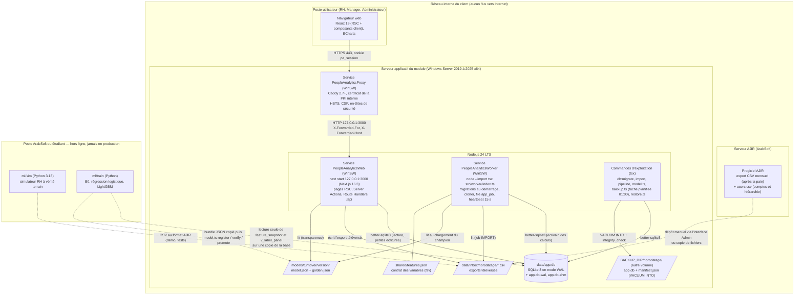

# Déploiement on-premise

Cible fixée par le cahier des charges (§ 5) : un seul serveur chez le client AJIR, Node.js LTS et un fichier SQLite, aucun Python ni Docker requis en production, HTTPS par un reverse proxy interne. Ce document décrit le déploiement tel que le dépôt le prévoit au 29/09/2026 (code, [deploy/](../../deploy/), guide [docs/INSTALLATION.md](../INSTALLATION.md), exploitation courante [docs/EXPLOITATION.md](../EXPLOITATION.md)) et signale ce qui reste à outiller.

## Diagramme de déploiement

## Nœuds et artefacts

| Nœud / artefact | Rôle | Référence |
|---|---|---|
| Navigateur | Rendu des pages ; ne reçoit que des DTO filtrés par rôle (HTML et payload RSC) | [src/app/](../../src/app/) |
| Reverse proxy TLS | Caddy en service Windows : terminaison HTTPS (obligatoire pour le cookie `Secure`), en-têtes `X-Forwarded-*`, HSTS, CSP, Permissions-Policy, COOP, corps de requête limité à 20 Mo ; IIS + ARR possible si le client l'impose (non décrit) | [deploy/caddy/Caddyfile](../../deploy/caddy/Caddyfile), [deploy/windows/PeopleAnalyticsProxy.xml](../../deploy/windows/PeopleAnalyticsProxy.xml) |
| Service web | `next start --hostname 127.0.0.1 --port 3000` en service WinSW ; authentification, DAL, pages, API, Server Actions ; ne calcule aucun score | [deploy/windows/PeopleAnalyticsWeb.xml](../../deploy/windows/PeopleAnalyticsWeb.xml), [next.config.ts](../../next.config.ts) |
| Service worker | Seul écrivain des résultats de calcul ; exécute la file `app_job` (sondage 5 s), le cron mensuel (`0 2 10 * *`, Africa/Tunis), la reprise des jobs périmés ; applique les migrations au démarrage | [src/worker/index.ts](../../src/worker/index.ts), [deploy/windows/PeopleAnalyticsWorker.xml](../../deploy/windows/PeopleAnalyticsWorker.xml) |
| `data/app.db` | Base unique ; WAL, `busy_timeout = 5000`, `synchronous = NORMAL`, `foreign_keys = ON` | [src/db/client.ts](../../src/db/client.ts) |
| `data/inbox/` | Exports téléversés (un dossier horodaté par dépôt, écriture `wx`) | [src/lib/dal/imports.ts](../../src/lib/dal/imports.ts) |
| `models/turnover/<version>/` | Bundles de modèles versionnés ; seul `b0-v1` est présent au moment de la rédaction | [models/turnover/b0-v1/model.json](../../models/turnover/b0-v1/model.json) |
| Sauvegardes (`BACKUP_DIR`, défaut `data/backups/`) | Copie à chaud `VACUUM INTO`, contrôle `integrity_check`, manifeste sha256, rétention 30 jours ; tâche planifiée quotidienne | [scripts/backup.ts](../../scripts/backup.ts), [scripts/restore.ts](../../scripts/restore.ts), [deploy/windows/backup.cmd](../../deploy/windows/backup.cmd) |
| Poste hors ligne | Python : simulateur et entraînement ; produit des CSV et des bundles JSON, n'écrit jamais dans la base de production | [ml/](../../ml/) |

## Configuration (variables d'environnement lues par le code)

| Variable | Effet | Lue dans |
|---|---|---|
| `DATABASE_PATH` | chemin de la base (défaut `data/app.db`) | [src/db/client.ts](../../src/db/client.ts) |
| `NODE_ENV=production` | cookie de session `Secure` | [src/lib/auth/session.ts](../../src/lib/auth/session.ts) |
| `INSECURE_COOKIES=1` | désactive `Secure` (démonstration en HTTP sur le réseau local uniquement) | idem |
| `APP_URL` | base des liens d'activation affichés à l'administrateur (https en production) | [src/app/(app)/admin/users/actions.ts](../../src/app/%28app%29/admin/users/actions.ts) |
| `LOG_LEVEL` | niveau des journaux pino (JSON sur la sortie standard) | [src/lib/logger.ts](../../src/lib/logger.ts) |
| `TRUST_PROXY` | nombre de proxys de confiance devant Next.js : `1` derrière Caddy (adresse client fiable pour la limitation de débit par IP et l'audit) ; absent ou `0` si le port de Next.js est joignable sans le proxy | [src/lib/auth/rate-limit.ts](../../src/lib/auth/rate-limit.ts) |
| `AJIR_LAUNCH_SECRET` | secret HMAC partagé avec AJIR (32 caractères au moins) ; absent = ouverture par jeton signé désactivée | [src/lib/dal/ajir.ts](../../src/lib/dal/ajir.ts) |
| `RETENTION_INBOX_DAYS`, `RETENTION_PREDICTION_MONTHS` | durées de rétention (priment sur les paramètres `retention_*`) | [scripts/retention.ts](../../scripts/retention.ts) |
| `BACKUP_DIR`, `BACKUP_RETENTION_DAYS` | dossier et rétention des sauvegardes | [scripts/backup.ts](../../scripts/backup.ts) |
| `PORT` | port du service web sondé par la restauration | [scripts/restore.ts](../../scripts/restore.ts) |

## Procédure d'installation

Résumé du guide [docs/INSTALLATION.md](../INSTALLATION.md) (installation sans Internet, sans Python ni Docker) :

1. Installer Node.js 24 LTS x64 ; créer un compte de service local et l'arborescence `C:\PeopleAnalytics\` (`app`, `data`, `logs`, `services`, `caddy`, `imports`) ; sauvegardes sur un autre volume, BitLocker sur les deux.
2. Copier le code livré (avec `node_modules` et `.next` construits) et renseigner `.env` d'après [deploy/env.example](../../deploy/env.example).
3. `npm run db:migrate` puis `npm run seed:admin -- <login> <mot de passe>`.
4. Premier import historique en ligne de commande (`npm run import`, qui construit aussi le calendrier et les agrégats) puis `npm run pipeline`.
5. Enregistrer les services WinSW `PeopleAnalyticsWeb` et `PeopleAnalyticsWorker` ([deploy/windows/](../../deploy/windows/)), ouvrir le pare-feu sur 443 (et 80 pour la redirection), le port 3000 restant local.
6. Installer Caddy en service `PeopleAnalyticsProxy` avec le [Caddyfile](../../deploy/caddy/Caddyfile) et le certificat PEM de la PKI du client.
7. Planifier la sauvegarde quotidienne à 01:00 ([deploy/windows/backup.cmd](../../deploy/windows/backup.cmd)) et lancer la vérification finale ([scripts/check-install.ts](../../scripts/check-install.ts)).

Non outillé dans le dépôt : l'archive d'installation win-x64 produite en intégration continue (le guide suppose une copie du code construit) et la configuration IIS + ARR.

## Règles d'exploitation qui découlent de l'architecture

- **Un seul écrivain de masse** : le worker. Les commandes `import`, `pipeline` et `model.ts` écrivent aussi en masse ; elles ne doivent pas tourner pendant un job du worker. Aucun verrou applicatif ne l'impose : c'est une règle d'exploitation (SQLite sérialise les écritures, `busy_timeout` absorbe 5 s d'attente, au-delà l'écriture échoue).
- **Sauvegarde à chaud** : `VACUUM INTO` produit une copie cohérente sans arrêter les services. **Restauration à froid** : `restore.ts` refuse de s'exécuter si la base est ouverte par un autre processus (sonde de verrou exclusif) ou si le service web répond, copie d'abord la base courante (`…_avant-restauration`), vérifie l'empreinte et l'intégrité, invalide les sessions et journalise `backup.restore`.
- **Supervision** : `GET /api/health` (public, sans donnée sensible) renvoie l'état de la base, l'âge du heartbeat du worker et le chargement du champion ; un heartbeat de plus de 10 minutes crée une alerte SYSTEME pour l'administrateur.
- **Mise à jour du modèle** : hors ligne, entraînement Python puis copie du bundle dans `models/turnover/<version>/` et `npx tsx scripts/model.ts register|verify|promote` ; aucune promotion depuis l'interface.

## Descriptions textuelles des cas d'utilisation (vue déploiement)

Pour chacun des 8 cas majeurs ([CAS_UTILISATION.md](CAS_UTILISATION.md)) : nœuds et processus mobilisés, préconditions d'exploitation, déroulement nominal et alternatives côté infrastructure.

| Cas | Acteur | Préconditions d'exploitation | Nœuds et déroulement nominal | Alternatives |
|---|---|---|---|---|
| UC-01 S'authentifier | tous | proxy TLS actif (cookie `Secure`) | navigateur → proxy → service web → `app.db` (`session`) | HTTP sans TLS : cookie refusé par le navigateur hors `localhost` (sauf `INSECURE_COOKIES=1`) |
| UC-02 Importer un export AJIR | Administrateur, Worker, AJIR | worker démarré ; espace disque pour `data/inbox` | navigateur → service web (écrit `data/inbox`, met un job en file) → worker (lit l'inbox, écrit `app.db`) | worker arrêté : le job reste `EN_FILE`, `/api/health` passe « dégradé », alerte SYSTEME après 10 min ; import CLI directement sur le serveur |
| UC-03 Batch mensuel | Worker | worker démarré le 10 à 02:00 ; données du mois importées | worker seul : `app.db` (agrégats, variables, run, publication) | worker tué : reprise au redémarrage ; batch CLI `npm run pipeline` |
| UC-04 Tableau de bord | RH, Manager | service web démarré | navigateur → proxy → service web (lecture `app.db`) | aucun run publié : données RH affichées sans bloc risque |
| UC-05 Fiche collaborateur | RH, Manager | service web démarré | navigateur → proxy → service web (lecture, écriture `audit_log`) | écriture d'audit impossible (base verrouillée plus de 5 s) : erreur 500, la fiche n'est pas servie |
| UC-06 Traiter une alerte | RH, Manager, Administrateur | service web démarré | navigateur → Server Action → `app.db` (`alert`, `audit_log`) | conflit concurrent : 409 |
| UC-07 Décider d'une recommandation | RH | service web démarré | navigateur → Server Action → `app.db` (`recommendation`, `intervention`, `audit_log`) | déjà traitée : 409 |
| UC-08 What-if | RH | champion lisible dans `model_version` ; `feature_snapshot` du mois présent | navigateur → `POST /api/employees/{id}/what-if` → service web (calcul en mémoire, lecture seule sauf audit) | variables du mois absentes : 422 ; aucun run : 409 |
