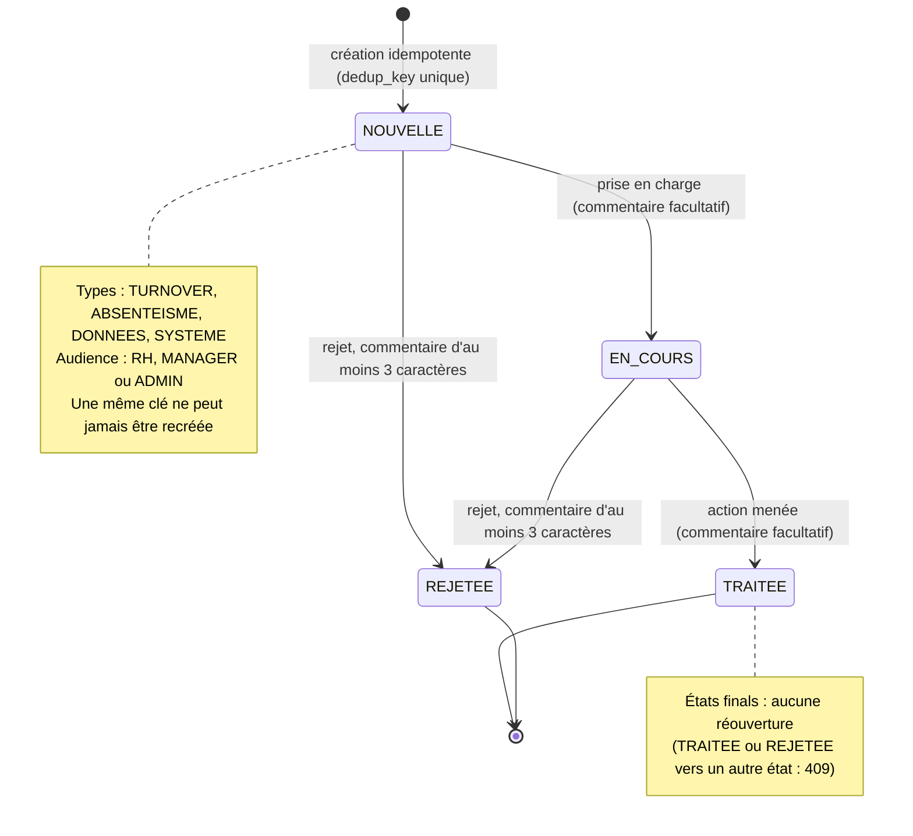
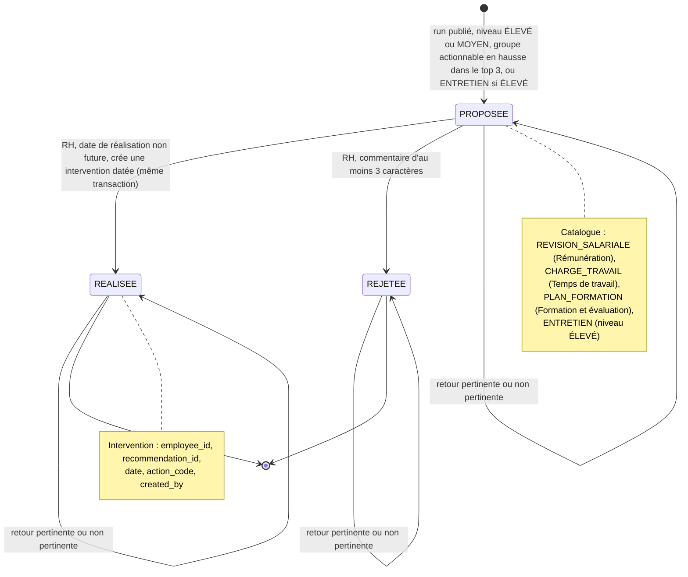
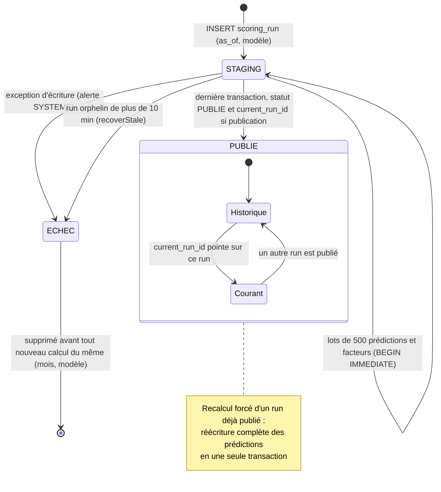
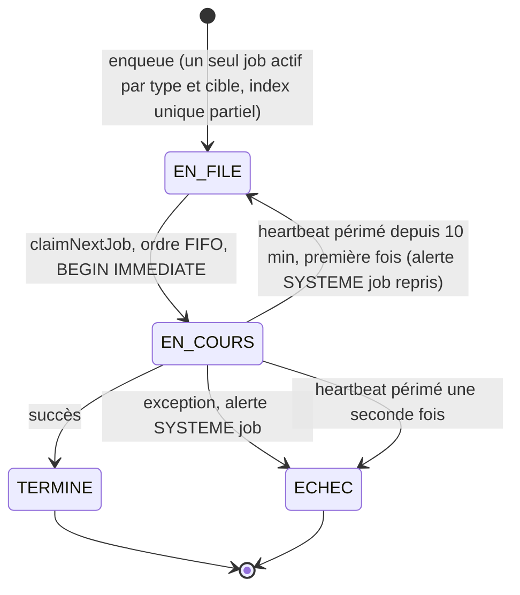
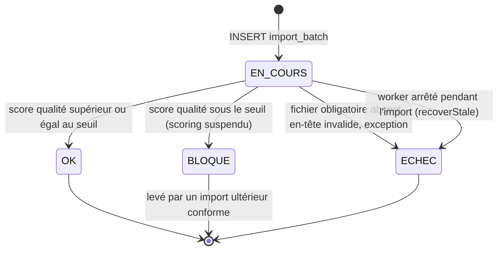

# Diagrammes d'états

États et transitions tels qu'ils sont codés (29/09/2026). Les deux premiers diagrammes (alerte, recommandation) répondent à la demande du cahier des charges (M7) ; les trois suivants (run de scoring, job, lot d'import) documentent les mécanismes de publication et de reprise sur lesquels reposent les critères de robustesse.

## 1. Alerte

Source : `ALERT_TRANSITIONS` et `updateAlert` dans [src/lib/dal/alerts.ts](../../src/lib/dal/alerts.ts) ; création dans [src/lib/engine/alerts.ts](../../src/lib/engine/alerts.ts) (`createAlert`, `INSERT OR IGNORE` sur `dedup_key`) et [src/lib/import/index.ts](../../src/lib/import/index.ts) (`raiseAlert`).

Règles de transition :

- Qui peut agir : tout utilisateur qui **voit** l'alerte (`visibility(ctx)`) — ADMIN : audience ADMIN et alertes DONNEES sans salarié ; RH : tout sauf l'audience ADMIN ; MANAGER : audience MANAGER de sa hiérarchie, jamais un signal d'absentéisme individuel.
- Contrôles : transition présente dans `ALERT_TRANSITIONS`, sinon 409 `TRANSITION_INVALIDE` ; mise à jour conditionnelle `WHERE id = ? AND status = <ancien>` (verrouillage optimiste), sinon 409 `CONFLIT` ; chaque transition journalisée `alert.update` (ancien et nouvel état).
- Origine des alertes et clés de déduplication :

| Type | Créée par | Audience | Clé |
|---|---|---|---|
| TURNOVER | publication d'un run : salarié ÉLEVÉ qui ne l'était pas au run publié précédent | MANAGER (donc aussi RH) | `turnover:<salarié>:<as_of>` |
| ABSENTEISME collective | `detectAnomalies` : taux d'équipe ou de département anormal deux semaines de suite (fenêtre d'alerte : 13 dernières semaines) | MANAGER | `absenteisme:<T manager ou D département>:<début>` |
| ABSENTEISME individuelle | facteur de Bradford ≥ `bradford_threshold`, formulée « à vérifier » | RH | `bradford:<salarié>:<mois>` |
| DONNEES | import avec rejets (ATTENTION), BLOQUE ou ECHEC (CRITIQUE) | RH (l'ADMIN la voit si aucun salarié n'est lié) | `import:<lot>` |
| SYSTEME | échec de job, job repris, worker sans heartbeat depuis 10 min, échec de scoring, champion invalide | ADMIN | `systeme:<motif>:…` |

Écart : le plan prévoyait un état **Obsolète** (alertes encore « Nouvelle » d'un run annulé) ; il n'est pas implémenté, faute de mécanisme de retour arrière du pointeur de run.

## 2. Recommandation

Source : création dans [src/lib/engine/recommendations.ts](../../src/lib/engine/recommendations.ts) (`applyPublicationEffects`), décision dans [src/lib/dal/recommendations.ts](../../src/lib/dal/recommendations.ts) (`decideRecommendation`, `setRecommendationFeedback`), Server Actions dans [src/app/(app)/employees/[id]/actions.ts](../../src/app/%28app%29/employees/[id]/actions.ts).

Règles :

- **Déclenchement** (idempotent) : pour chaque prédiction ÉLEVÉ ou MOYEN du run publié, chacun des 3 premiers facteurs dont le groupe est `actionable` dans [shared/features.json](../../shared/features.json) et dont la contribution est en HAUSSE propose l'action du groupe ; un niveau ÉLEVÉ ajoute `ENTRETIEN`. Jamais depuis les groupes Carrière et contrat, Absences ou Équipe.
- **Anti-doublon** : une action n'est pas reproposée à un salarié tant qu'une recommandation identique est `PROPOSEE`, ni une seconde fois pour le même mois scoré (même après rejet ou réalisation).
- **Décision** : RH seulement (`requireGlobal`) ; une recommandation déjà traitée renvoie 409 `DEJA_TRAITEE` ; journalisation `recommendation.decide` et `recommendation.feedback`.
- **Vue manager** : lecture seule des recommandations de sa hiérarchie, hors `REVISION_SALARIALE` (`RH_ONLY_ACTIONS`).
- **Écart** : les interventions ne sont pas encore exploitées au réentraînement (censure prévue au plan).

## 3. Run de scoring (publication atomique)

Source : `scoreMonth` dans [src/lib/scoring/score.ts](../../src/lib/scoring/score.ts), `recoverStale` dans [src/lib/jobs/index.ts](../../src/lib/jobs/index.ts).

Un run `PUBLIE` non pointé (backtest `npm run pipeline -- --backtest`, ou mois antérieur au calcul courant demandé par l'API) reste consultable dans l'historique des fiches mais ne déclenche ni recommandation ni alerte. Seul le run pointé et `PUBLIE` est lu par l'interface (`getPublishedRun`).

## 4. Job de la file `app_job`

Source : [src/lib/jobs/index.ts](../../src/lib/jobs/index.ts), [src/worker/run.ts](../../src/worker/run.ts).

## 5. Lot d'import

Source : `runImport` dans [src/lib/import/index.ts](../../src/lib/import/index.ts).

Si le worker est tué pendant un import, `recoverStale` ([src/lib/jobs/index.ts](../../src/lib/jobs/index.ts)) passe le lot `import_batch` resté `EN_COURS` pour ce job en `ECHEC` (audité, « Import interrompu »), puis remet le job en file une fois ; aucun import « en cours » fantôme ne reste dans *Santé des données* ([tests/features/import-job.test.ts](../../tests/features/import-job.test.ts)).

## Descriptions textuelles des cas d'utilisation illustrés

### UC-06 — Traiter une alerte

- **Acteurs** : Responsable RH, Manager, Administrateur (selon l'audience).
- **Préconditions** : alerte créée par le système et visible par l'utilisateur ; session valide.
- **Scénario nominal** :
  1. L'utilisateur ouvre `/alerts` : alertes visibles triées par statut (Nouvelle, En cours, puis closes), sévérité et date ; filtres par type, statut, sévérité.
  2. Il ouvre le détail, lit le message (formulé « estimation », « à vérifier ») et suit le lien (fiche, absentéisme, santé des données).
  3. Il passe l'alerte `EN_COURS`, puis `TRAITEE`, avec un commentaire facultatif ; chaque transition est journalisée.
- **Alternatives** :
  - A1 rejet depuis `NOUVELLE` ou `EN_COURS` avec commentaire obligatoire.
  - A2 transition non prévue : 409 ; modification concurrente : 409.
  - A3 alerte hors visibilité : 403 et `alert.view`/`alert.update` REFUSE ; inexistante : 404.

### UC-07 — Décider d'une recommandation

- **Acteur** : Responsable RH.
- **Préconditions** : recommandation `PROPOSEE` issue du dernier run publié ou d'un run antérieur.
- **Scénario nominal** :
  1. Depuis la zone Suggestions de la fiche ou la page *Recommandations* (KPI d'adoption), la RH choisit « réalisée », saisit la date et, facultativement, un retour.
  2. La recommandation passe `REALISEE` et une intervention datée est créée dans la même transaction ; l'action est journalisée.
- **Alternatives** :
  - A1 rejet avec commentaire obligatoire, sans intervention.
  - A2 retour « pertinente / non pertinente » seul, dans n'importe quel état.
  - A3 déjà traitée : 409 ; date future : refus de validation.
  - A4 Manager ou Administrateur : 403 journalisé.
