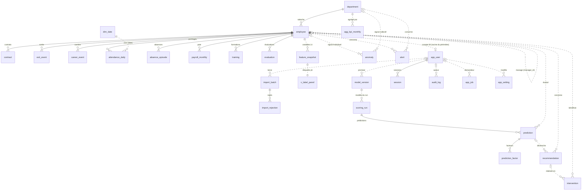
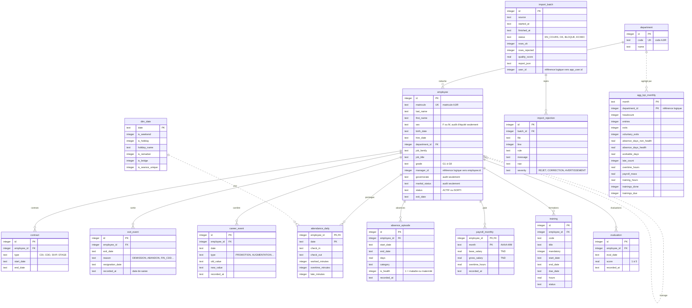
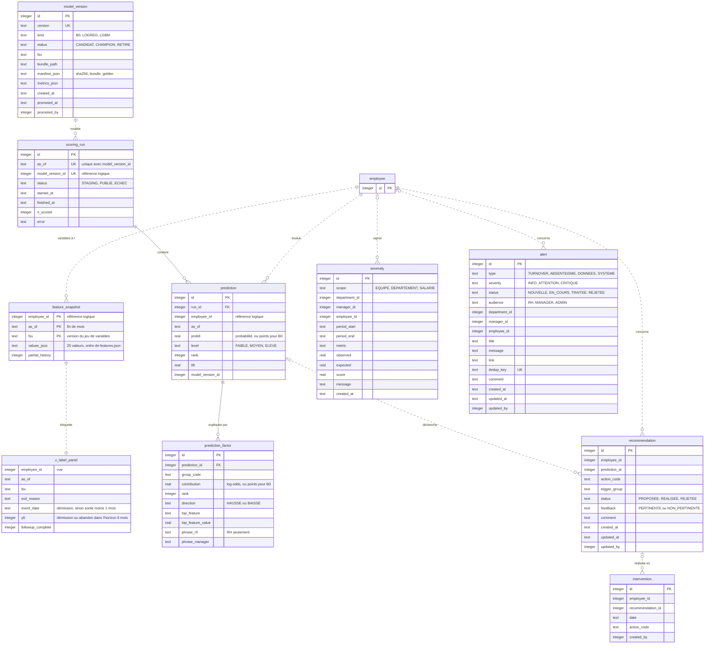
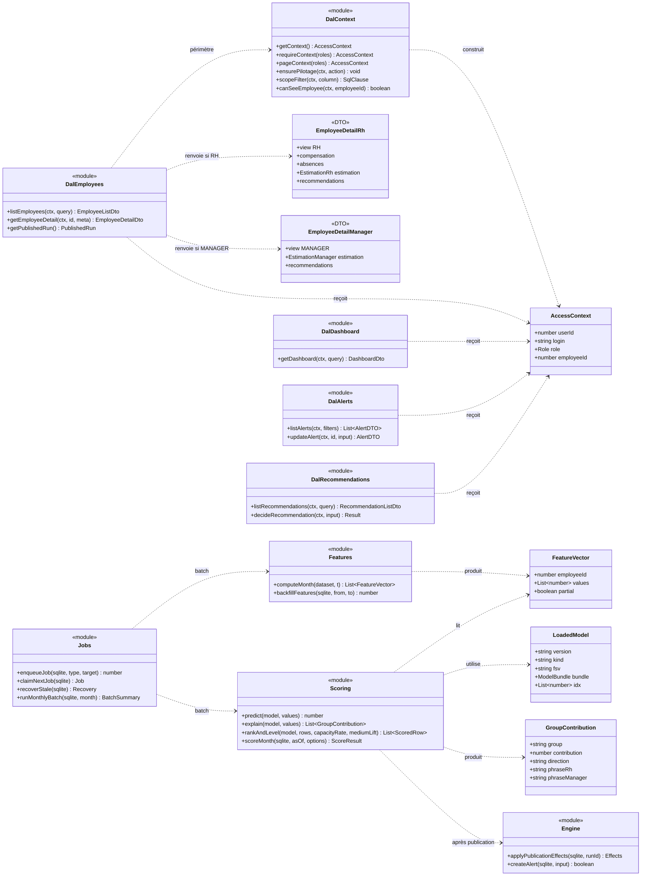

# Modèle de données et diagramme de classes

Source de vérité : le schéma Drizzle [src/db/schema.ts](../../src/db/schema.ts) et les migrations [drizzle/](../../drizzle/) (`0000_init.sql` tables et index, `0001_audit_triggers.sql` triggers d'ajout seul et vue `v_label_panel`, `0002` sévérité des rejets, `0003` nouvelle définition de la vue). La signification de chaque colonne est donnée dans [docs/DICTIONNAIRE.md](../DICTIONNAIRE.md).

La base compte **28 tables et 1 vue**, organisées en cinq familles :

| Famille | Tables | Écrivain |
|---|---|---|
| Sources AJIR (lecture seule pour l'application) | `department`, `employee`, `contract`, `exit_event`, `career_event`, `attendance_daily`, `absence_episode`, `payroll_monthly`, `training`, `evaluation` | import (worker ou CLI) |
| Calendrier et imports | `dim_date`, `import_batch`, `import_rejection` | CLI (`buildCalendar`), import |
| Agrégats | `agg_kpi_monthly` | `refreshAggregates` (worker ou CLI) |
| Couche ML, résultats de calcul et objets métier | `feature_snapshot`, `model_version`, `scoring_run`, `prediction`, `prediction_factor`, `recommendation`, `intervention`, `anomaly`, `alert`, vue `v_label_panel` | worker ou CLI ; Next.js ne modifie que les statuts (alertes, recommandations) et crée les interventions |
| Application | `app_user`, `session`, `audit_log`, `app_job`, `app_setting` | Next.js et worker |

Notation : trait plein = clé étrangère **déclarée** en base (`REFERENCES`, contrôlée car `foreign_keys = ON`) ; trait pointillé = référence **logique** portée par une colonne `*_id` sans contrainte (choix de l'implémentation : les tables de résultats et d'application ne bloquent pas un réimport des sources).

## 1. Vue d'ensemble des relations

## 2. Sources AJIR, calendrier, imports et agrégats

Index : `employee(department_id)`, `employee(manager_id)`, `contract(employee_id)`, `exit_event(employee_id)`, `career_event(employee_id, date)`, `attendance_daily(date)` (supprimé puis reconstruit pendant un import de pointages de plus de 16 Mo), `absence_episode(employee_id, start_date)`, `training(employee_id)`, `evaluation(employee_id, eval_date)`, `import_rejection(batch_id)`. Unicité applicative : l'import n'accepte qu'une sortie par salarié, un contrat par (salarié, date de début), une absence par (salarié, date de début), un événement par (salarié, date, type).

## 3. Couche ML, résultats de calcul et objets métier

Contraintes notables : index unique partiel `model_one_champion` (un seul `CHAMPION`) ; index unique `run_asof_model` sur `(as_of, model_version_id)` (non partiel : un run en échec est supprimé avant d'être recalculé) ; `alert.dedup_key` unique (création idempotente `INSERT OR IGNORE`) ; index `prediction(run_id, employee_id)`, `prediction(employee_id, as_of)`, `prediction_factor(prediction_id)`, `recommendation(employee_id)`, `anomaly(period_start)`, `alert(status, type)`, `feature_snapshot(as_of, fsv)`.

## 4. Application : comptes, sessions, audit, jobs, paramètres

```mermaid
erDiagram
  app_user {
    integer id PK
    text login UK
    text password_hash "argon2id, NULL tant que non activé"
    text role "ADMIN, RH, MANAGER"
    integer employee_id "référence logique, obligatoire pour MANAGER"
    text email
    integer active
    integer failed_attempts
    text locked_until
    text activation_token_hash "SHA-256"
    text activation_expires_at
    text created_at
  }
  session {
    text id PK "SHA-256 du jeton"
    integer user_id FK
    text created_at
    text expires_at
    text ip
    text user_agent
  }
  audit_log {
    integer id PK
    text at
    integer user_id
    text action
    text target_type
    text target_id
    text outcome "OK, REFUSE, ECHEC"
    text detail_json
    text ip
  }
  app_job {
    integer id PK
    text type "IMPORT, AGGREGATE, FEATURES, SCORING, ANOMALIES, BATCH_MENSUEL"
    text target
    text status "EN_FILE, EN_COURS, TERMINE, ECHEC"
    text payload_json
    text created_at
    text started_at
    text finished_at
    text heartbeat_at
    text error
    integer created_by
  }
  app_setting {
    text key PK
    text value
    text updated_at
    integer updated_by
  }
  employee {
    integer id PK
  }

  employee |o..o| app_user : "compte lié"
  app_user ||--o{ session : "sessions"
  app_user |o..o{ audit_log : "auteur"
  app_user |o..o{ app_job : "demandeur"
  app_user |o..o{ app_setting : "modifie"
```

Contraintes notables : triggers `audit_log_no_update` et `audit_log_no_delete` (`RAISE(ABORT)`) ; index unique partiel `job_one_active` sur `(type, target)` pour les jobs `EN_FILE` ou `EN_COURS` ; index `session(user_id)`, `audit_log(at)`, `app_job(status)`.

## 5. Diagramme de classes de la couche applicative

Le code est fonctionnel (modules TypeScript exportant des fonctions et des types), pas orienté objet ; le diagramme représente chaque module comme une classe stéréotypée « module » et chaque type structurant comme une classe de données. Il montre la règle centrale : toute lecture passe par la DAL avec un `AccessContext`, et le calcul (variables, scoring, moteur) est indépendant de Next.js.

## Descriptions textuelles des cas d'utilisation (vue données)

Pour chacun des 8 cas majeurs décrits dans [CAS_UTILISATION.md](CAS_UTILISATION.md) : acteur, préconditions sur les données, tables lues et écrites dans le scénario nominal, et effet des alternatives sur les données.

| Cas | Acteur | Préconditions (données) | Scénario nominal : lecture → écriture | Alternatives |
|---|---|---|---|---|
| UC-01 S'authentifier | tous | `app_user` actif avec `password_hash` | lit `app_user` → écrit `app_user.failed_attempts`, `session`, `audit_log` | échec : `app_user.failed_attempts`/`locked_until`, `audit_log` REFUSE ; déconnexion : suppression de `session` |
| UC-02 Importer un export AJIR | Administrateur, Worker | aucun `app_job` IMPORT actif | lit les CSV, `app_setting` (seuil, SMIG, délais) → écrit `app_job`, `import_batch`, les dix tables sources, `import_rejection`, `app_setting.data_end_date`, `app_user`, `alert` (DONNEES), `audit_log` | BLOQUE ou ECHEC : `import_batch.status`, alerte CRITIQUE ; les lignes valides restent écrites |
| UC-03 Batch mensuel | Worker | dernier `import_batch` non BLOQUE, `model_version` champion | lit sources, `dim_date`, `model_version` → écrit `agg_kpi_monthly`, `feature_snapshot`, `scoring_run`, `prediction`, `prediction_factor`, `app_setting.current_run_id`, `recommendation`, `alert`, `anomaly`, `audit_log`, `app_job` | échec : `scoring_run.status = ECHEC`, `alert` SYSTEME, pointeur inchangé |
| UC-04 Tableau de bord | RH, Manager | `agg_kpi_monthly` à jour, run publié | lit `agg_kpi_monthly` (ou les sources), `prediction` du run courant, `employee`, `department` → aucune écriture | ADMIN : `audit_log` REFUSE |
| UC-05 Fiche collaborateur | RH, Manager | salarié existant | lit `employee`, `contract`, `payroll_monthly`, `absence_episode`, `training`, `evaluation`, `career_event`, `prediction`, `prediction_factor`, `recommendation`, `intervention` → écrit `audit_log` (`employee.view` OK) | hors périmètre : `audit_log` REFUSE seulement |
| UC-06 Traiter une alerte | RH, Manager, Administrateur | `alert` visible | lit `alert` → écrit `alert.status`, `comment`, `updated_*`, `audit_log` | transition invalide ou conflit : aucune écriture ; hors visibilité : `audit_log` REFUSE |
| UC-07 Décider d'une recommandation | RH | `recommendation.status = PROPOSEE` | lit `recommendation` → écrit `recommendation` et `intervention` (même transaction), `audit_log` | rejet : `recommendation` seule ; déjà traitée : aucune écriture |
| UC-08 What-if | RH | run publié, `prediction` du salarié, `model_version.manifest_json` | lit les sources du salarié, `feature_snapshot` du mois → écrit `audit_log` seulement | 409/422 : `audit_log` ECHEC ou aucune écriture |
