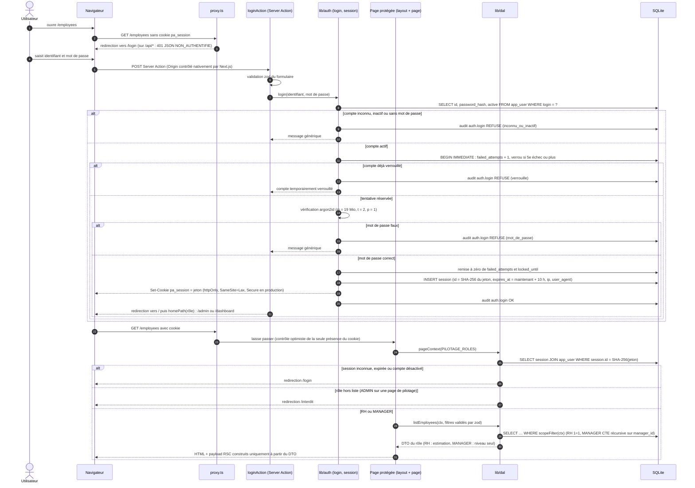
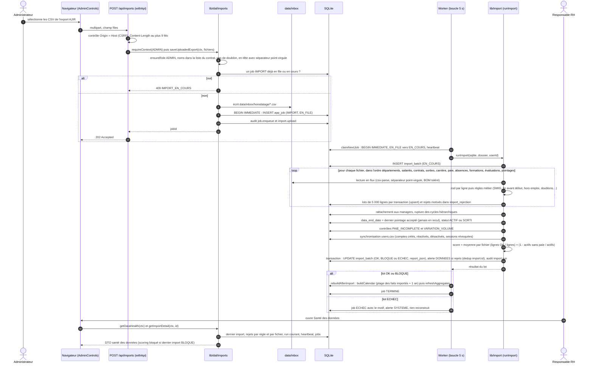
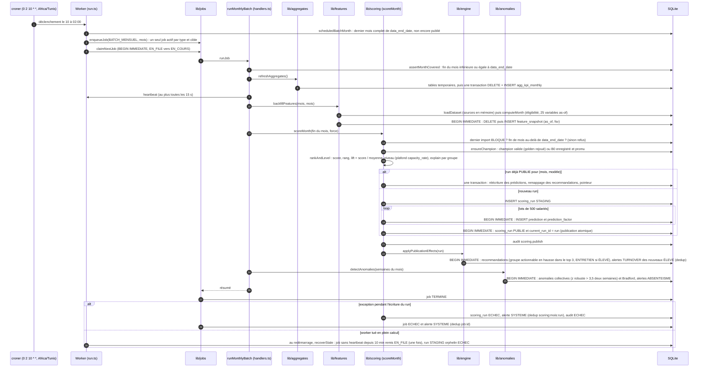
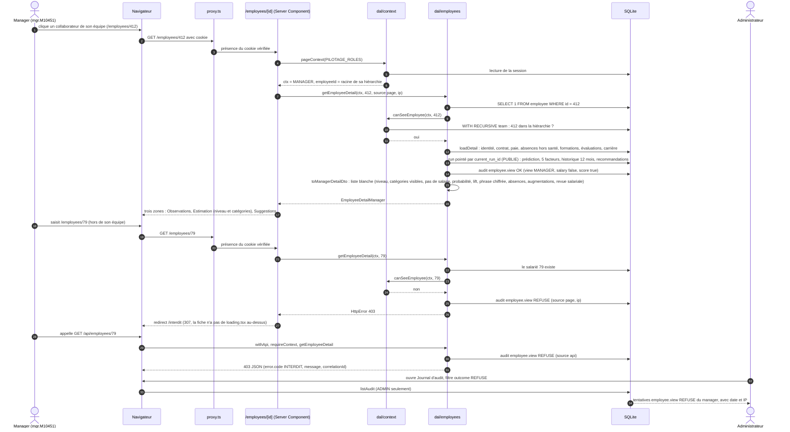
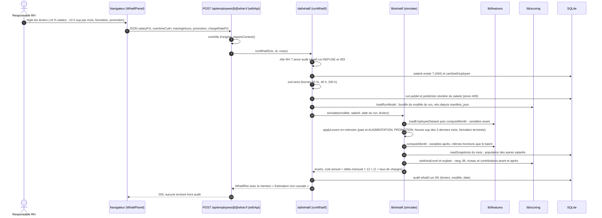

# Diagrammes de séquence

Cinq scénarios, tracés d'après le code (état au 29/09/2026). Chaque participant renvoie à un fichier réel ; les requêtes SQL sont résumées. Conventions : `BEGIN IMMEDIATE` = transaction better-sqlite3 `.immediate()` qui prend le verrou d'écriture dès le début ; « audit » = insertion dans `audit_log` (table en ajout seul).

| # | Scénario | Fichiers principaux |
|---|---|---|
| 1 | Connexion et contrôle d'accès par rôle | [src/proxy.ts](../../src/proxy.ts), [src/app/login/actions.ts](../../src/app/login/actions.ts), [src/lib/auth/](../../src/lib/auth/), [src/lib/dal/context.ts](../../src/lib/dal/context.ts) |
| 2 | Import d'un export AJIR avec contrôle qualité | [src/app/api/imports/route.ts](../../src/app/api/imports/route.ts), [src/lib/dal/imports.ts](../../src/lib/dal/imports.ts), [src/lib/import/](../../src/lib/import/), [src/worker/run.ts](../../src/worker/run.ts) |
| 3 | Batch mensuel : variables → scoring → publication → alertes | [src/lib/jobs/handlers.ts](../../src/lib/jobs/handlers.ts), [src/lib/features/](../../src/lib/features/), [src/lib/scoring/score.ts](../../src/lib/scoring/score.ts), [src/lib/engine/](../../src/lib/engine/), [src/lib/anomalies/index.ts](../../src/lib/anomalies/index.ts) |
| 4 | Consultation d'une fiche par un manager, y compris refus hors périmètre | [src/app/(app)/employees/[id]/page.tsx](../../src/app/%28app%29/employees/[id]/page.tsx), [src/lib/dal/employees.ts](../../src/lib/dal/employees.ts) |
| 5 | What-if (Should, en cours de livraison) | [src/app/api/employees/[id]/what-if/route.ts](../../src/app/api/employees/[id]/what-if/route.ts), [src/lib/dal/whatif.ts](../../src/lib/dal/whatif.ts), [src/lib/whatif/index.ts](../../src/lib/whatif/index.ts) |

## 1. Connexion et contrôle d'accès par rôle

Points de conception :

- Le proxy ([src/proxy.ts](../../src/proxy.ts)) ne lit pas la base : il ne fait que rediriger tôt les visiteurs sans cookie. L'autorisation réelle est refaite à chaque rendu par `pageContext` / `requireContext`, puis par la DAL (voir [ADR-007](../adr/007-couche-acces-donnees-au-lieu-rls.md)).
- Un refus de rôle au niveau page (`/interdit`) ou route (`requireContext(roles)` → 403) n'est pas journalisé ; les refus décidés dans la DAL (`ensureRole`, `ensurePilotage`, `canSeeEmployee`, visibilité des alertes) le sont.
- Le cookie ne contient qu'un jeton aléatoire ; la base n'en garde que l'empreinte (voir [ADR-012](../adr/012-sessions-opaques-plutot-que-jwt.md)).

## 2. Import d'un export AJIR avec contrôle qualité

Alternatives :

- **Score sous `quality_threshold`** (0,95 par défaut) : statut `BLOQUE`, alerte DONNEES CRITIQUE ; `requestScoring`, `requestRecompute` (409 `SCORING_BLOQUE`) et `scoreMonth` refusent de calculer. Les lignes valides sont néanmoins déjà écrites dans les tables sources (l'import n'est pas transactionnel de bout en bout : c'est le calcul qui est bloqué, pas l'écriture).
- **Fichier obligatoire absent ou en-tête invalide** : exception, statut `ECHEC`.
- **Import en ligne de commande** ([scripts/import.ts](../../scripts/import.ts)) : même `runImport`, suivi de `buildCalendar` et `refreshAggregates`, comme le job `IMPORT` du worker (`rebuildAfterImport`, [src/lib/jobs/handlers.ts](../../src/lib/jobs/handlers.ts)), qui ne reconstruit rien si le lot est en `ECHEC`.
- **Worker arrêté pendant l'import** : `recoverStale` ([src/lib/jobs/index.ts](../../src/lib/jobs/index.ts)) passe en `ECHEC` (audité, « Import interrompu ») le lot `import_batch` resté `EN_COURS` pour ce job, puis remet le job en file une fois (seconde interruption : job `ECHEC`). Couvert par [tests/features/import-job.test.ts](../../tests/features/import-job.test.ts).

## 3. Batch mensuel : variables → scoring → publication → alertes

Invariant : tant que la dernière transaction n'a pas eu lieu, `current_run_id` désigne le run précédent ; toutes les lectures de l'interface passent par `getPublishedRun()` qui n'accepte qu'un run `PUBLIE` pointé ([ADR-008](../adr/008-publication-atomique-par-pointeur.md)). Les recommandations et alertes sont créées après la publication, hors de la transaction de bascule, et sont idempotentes (clés de déduplication), si bien qu'un rejeu ne crée pas de doublon.

Variantes de déclenchement : `npm run pipeline` ([scripts/pipeline.ts](../../scripts/pipeline.ts)) exécute les mêmes étapes en ligne de commande (avec `--backtest` : un run par mois, seul le dernier publié) ; `POST /api/predictions/run` (RH, ADMIN) met en file un job `SCORING` ; le bouton « Recalculer » de *Santé des données* (ADMIN) met en file un `BATCH_MENSUEL`.

## 4. Consultation d'une fiche par un manager, y compris refus hors périmètre

Alternatives : identifiant inexistant → 404 (`notFound()` sur la page, `INTROUVABLE` sur l'API) sans audit ; identifiant non numérique → 404 ; la fiche de son propre salarié racine n'est pas dans le périmètre (la CTE exclut le manager lui-même) → 403 ; un ADMIN est refusé de la même façon (séparation des tâches).

## 5. What-if (Should, en cours de livraison)

Le what-if est livré en parallèle par un autre contributeur ; ce diagramme suit le code présent au moment de la rédaction ([src/lib/dal/whatif.ts](../../src/lib/dal/whatif.ts), [src/lib/whatif/index.ts](../../src/lib/whatif/index.ts), [src/components/pilotage/what-if-panel.tsx](../../src/components/pilotage/what-if-panel.tsx)) et devra être relu une fois le module stabilisé.

Écarts avec le cahier des charges et le plan : la réponse ne contient pas de « courbe » à 3, 6 et 12 mois (le modèle ne prédit que l'horizon 6 mois) ; la latence visée de 300 ms n'a pas été mesurée.

## Descriptions textuelles des cas d'utilisation illustrés

Les cas ci-dessous sont ceux que ces séquences détaillent ; la liste complète figure dans [CAS_UTILISATION.md](CAS_UTILISATION.md).

### UC-01 — S'authentifier (séquence 1)

- **Acteurs** : Administrateur, Responsable RH, Manager.
- **Préconditions** : compte actif avec mot de passe ; HTTPS en production.
- **Scénario nominal** : redirection vers `/login` par le proxy ; saisie ; validation zod ; réservation de la tentative (`BEGIN IMMEDIATE`) ; vérification argon2id ; session opaque (cookie httpOnly, empreinte SHA-256 en base, 10 h) ; audit `auth.login` OK ; redirection vers `/admin` ou `/dashboard`.
- **Alternatives** : compte inconnu ou inactif (message générique, REFUSE) ; mot de passe faux (compteur, verrouillage progressif dès le 5e échec) ; compte verrouillé ; page hors rôle → `/interdit` ; API hors rôle → 403.

### UC-02 — Importer un export AJIR avec contrôle qualité (séquence 2)

- **Acteurs** : Administrateur, Worker, AJIR.
- **Préconditions** : export conforme au contrat CSV ; aucun import en cours.
- **Scénario nominal** : téléversement (contrôles d'origine, de rôle, de noms, de taille, d'en-tête) ; dépôt dans `data/inbox` ; job `IMPORT` ; traitement en flux avec rejets motivés ; hiérarchie, fin des données, statuts, contrôles de complétude et de volume ; synchronisation des comptes ; score qualité ; statut, alerte DONNEES, audit.
- **Alternatives** : score sous le seuil (BLOQUE, scoring suspendu) ; fichier obligatoire manquant (ECHEC) ; refus immédiat d'un dépôt non conforme ; import CLI avec calendrier et agrégats.

### UC-03 — Exécuter le batch mensuel (séquence 3)

- **Acteurs** : Worker ; Administrateur (relance) ; RH ou Administrateur (scoring via l'API).
- **Préconditions** : dernier import non BLOQUE ; mois couvert par les données ; champion valide.
- **Scénario nominal** : cron → job → agrégats → variables → run STAGING par lots → publication atomique du pointeur → recommandations et alertes TURNOVER idempotentes → anomalies d'absentéisme → job TERMINE.
- **Alternatives** : échec d'écriture (run ECHEC, alerte SYSTEME, pointeur inchangé) ; worker tué (reprise unique puis ECHEC) ; rien à faire (mois déjà publié ou non importé).

### UC-05 — Consulter une fiche collaborateur (séquence 4)

- **Acteurs** : Responsable RH, Manager.
- **Préconditions** : session valide, salarié existant.
- **Scénario nominal** : garde de page ; existence ; périmètre ; chargement des observations, de l'estimation publiée et des recommandations ; audit `employee.view` OK ; DTO du rôle ; affichage en trois zones.
- **Alternatives** : hors périmètre (REFUSE journalisé, `/interdit` ou 403 JSON) ; inexistant (404) ; non évalué ou aucun run ; champion B0 (score à règles) ; Administrateur refusé.

### UC-08 — Simuler un what-if (séquence 5, Should)

- **Acteur** : Responsable RH.
- **Préconditions** : run publié ; salarié évalué ; bundle du modèle lisible.
- **Scénario nominal** : réglage des leviers ; validation stricte ; recalcul des variables avant/après en mémoire à la date du run ; placement dans la population du mois ; contributions par groupe ; coût annuel en TND ; mention non causale ; audit `whatif.run`.
- **Alternatives** : aucun run ou salarié non évalué (409) ; levier inapplicable (422, audit ECHEC) ; rôle non RH (403 journalisé) ; sources modifiées depuis le calcul (note d'avertissement).
